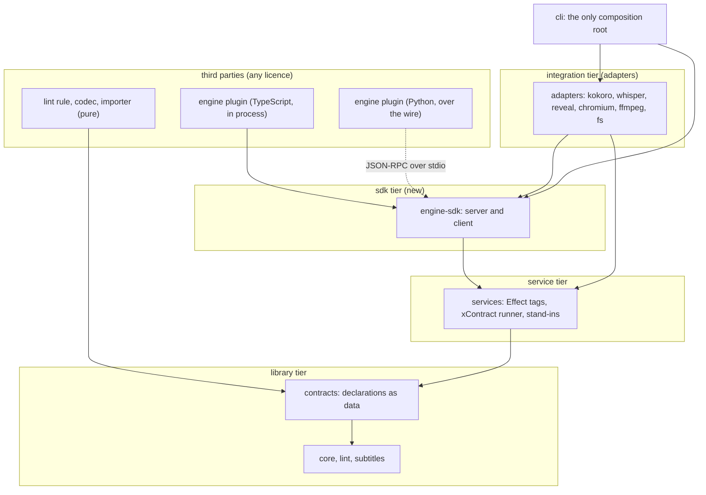
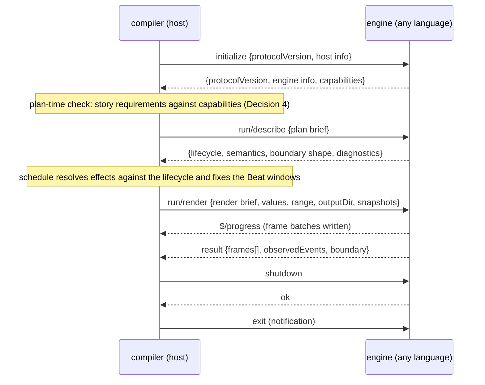
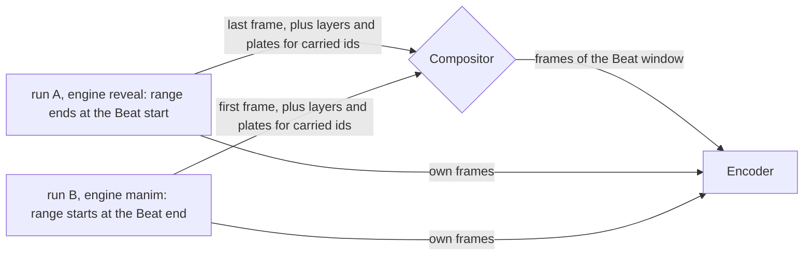
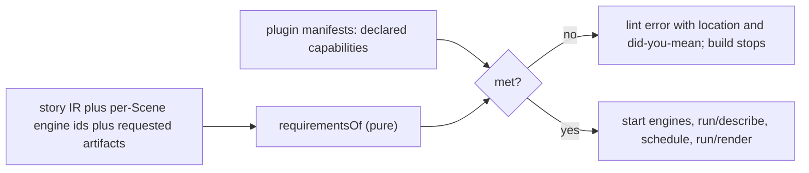

# ADR-0000: Extension architecture: where contracts live and how third parties extend tsukuri

**Date:** 2026-10-29
**Status:** Proposed, confirmed decision by decision (operator, 2026-10-29, `reebeat-D7`: "the extension ADR-0000 is adopted in stages; open points are tagged unstable"). Points stay **unstable** until a second real engine has run the protocol, and may change in a minor release of their contract (Decision 5). A decision's head says **Proposed**; only the parts inside it marked **Decided** come from the operator, with the date. The source for every **Decided** mark is the operator decisions log of October 2026, cited by decision id, date and line: its public copy is `sources/operator-decisions-2026-10.md` in the `tsukuri-labs/.github` repository (the line numbers are those of that copy).

**Declarative multimedia: accessible, reproducible, rebuilt as you edit.** *We take care of building; you focus on creating.* **Semantically declared story beats, compiled into multimedia artifacts: statecharts for structure, functional reactive time, and an incremental build graph, written in Effect.** This record fixes where its extension contracts are declared, which extension points exist, how an engine written in another language talks to the compiler, how the compiler checks a story against what an engine can do, how contracts are versioned, how a plugin is packaged and trusted, and what every plugin owes the determinism guarantee. Throughout, *creating* is what authors do and *building* is what tsukuri does.

## Context

### What exists

- **Seven services**, each an Effect service tag with a contract suite (`packages/services/src`, `packages/services/contract`): `SpeechSynthesizer`, `WordAligner`, `SoundLibrary`, `Renderer`, `FrameCapturer`, `Encoder`, `AssetCache`. Four have offline stand-ins (`packages/services/standins`: `silentSynthesizer`, `evenAligner`, `toneSounds`, `memoryCache`). The three tiers are library < service < integration, enforced by `bun run check:tiers` (`tools/quality/tiers.ts`; design R3 in [`keyframe-engine.md`](../design/keyframe-engine.md)).
- **Contract suites.** `AGENTS.md` calls the pattern `xContract(label, layer)`; in code each service has its own function (`rendererContract`, `encoderContract`, and so on), built on `registerClauses`, which registers one test per clause (`packages/services/contract/clause.ts`). A clause has an id, a sentence (`means`) and an Effect. `failingClauses` returns the ids that fail, which is how the stand-ins prove the suite can fail. The clause bodies assert with `@effect/vitest`, and `clause.ts` imports it; a runner without vitest needs that to change (Decision 3).
- **Selection** is one closed registry, `choices` in `packages/services/src/selection.ts`. An unknown value fails `UnknownSelection`. A missing model, binary or credential fails `AdapterUnavailable`. Nothing falls back.
- **`AdapterInfo`** carries `id`, `settings` and `egress` (`packages/services/src/types.ts`). The build prints each adapter's egress and writes it to `build.json`. `RendererInfo` adds a declared `lifecycle`: when each Element event happens in the slide change. `schedule` resolves effects from it and `verify` observes it in the written video, so a wrong declaration fails.
- **The open-core note** says the adapter seams are "the plugin API", and leaves "extension points beyond adapters" open ([`open-core-boundary.md`](../design/open-core-boundary.md)).

### What is new

| Item | Status |
| --- | --- |
| The model: a story is a statechart. A **State** is a node, a **Beat** is a generated edge, a **Scene** is a compound State. Identity is story-wide. Effects subscribe to generated events, with SMIL-style combinators. Curves are data. Time is exact (whole flicks) on three clocks: logical, media, frame. See [PR #17](https://github.com/tsukuri-labs/tsukuri/pull/17) (spec 0004) and [spec 0007](../specs/0007-scxml-persistent-ir-spike.md). | Decided (operator, 2026-10-29) |
| Three kinds of format: IR codecs, artifact renderers, importers. | Decided (operator, 2026-10-29) |
| Open core: the compiler, the formats, the plugin seams and the agent tool protocol are open; products are closed. | Decided (operator, 2026-10-29), see [`open-core-boundary.md`](../design/open-core-boundary.md) |
| Experimental dependencies are pinned exactly and their types never appear in the public API. | Decided (operator, 2026-10-29) |
| **Multiple render engines, chosen per Scene.** `reveal` today; Manim, Motion Canvas and others later. A Beat between Scenes on different engines uses a compositor transition on boundary frames, plus snapshot carry-over for shared ids. tsukuri provides an SDK for building render engines. | Decided (operator, 2026-10-29) |
| Plugin peer ranges: a plugin that uses an unstable contract caps its range below the next minor. | **Proposed** (a rule the lead relayed as agreed on 2026-10-29; no operator decision is recorded; question 11 asks the operator to confirm) |
| **Interactions are elements.** An interaction declares the event it raises, with a Schema-typed payload, a label and a description; each artifact renderer realises it by its capabilities. Artifact renderers are **static** (video, VTT, Fountain, PDF: build-time realisation only) or **dynamic** (website, Deck runtime: realised at view time). *Authoring tools* act on creational formats (the story IR and its codecs); *interaction tools* act on produced artifacts. See [issue #19](https://github.com/tsukuri-labs/tsukuri/issues/19). | Decided (operator, 2026-10-29) |
| The interactive website artifact (issue #19) and viewer input events (issue #20) are later, not v1; #20 waits for an investigation. | Decided (operator, 2026-10-29) |
| React's core (reconciler and scheduler) is **not** tsukuri's engine core; React stays possible as one render engine under the SDK and JSX as an authoring importer. The layering is statechart, per-artifact plan, build DAG. | Decided (operator, 2026-10-29) |
| **Adoption in stages.** This record is confirmed decision by decision, and its open points are unstable until a second real engine has run the protocol (`reebeat-D7`, log line 86). | Decided (operator, 2026-10-29) |
| **Story IR and timeline IR.** The story IR is public and versioned; the timeline IR (the Plan after scheduling, with frames) is an **unstable build artifact**, never decoded back and not a contract plugins may rely on; flicks stay the unit of exact time (`reebeat-D6`, log line 85). | Decided (operator, 2026-10-29) |
| **Interaction realisation.** One interaction declaration; an artifact that cannot realise it fails at plan time for that output; a flag bypasses it, so the drift is silent but explicit, a declared opt-out and never a default (`reebeat-D8`, log line 87). The form of the flag and the recording of the bypass are **Proposed** (question 12). See "Interactions" in Decision 2 and the `cap/interaction-unrealisable` rule in Decision 4. | Decided (operator, 2026-10-29), except the form and recording of the bypass |
| **Agent tool protocol.** Tools are declared once, protocol-neutrally, with MCP as the first adapter (`agent-protocol`, log line 77). Resolves open question 10 of the first version of this record. | Decided (operator, 2026-10-29) |
| **Reproducibility.** Bytes for data artifacts; identical decoded frames and audio for video (`reproducible`, log line 81). | Decided (operator, 2026-10-29) |

### The four aims every decision serves

The operator's stated intent (2026-10-29, **Decided**) names four aims. An extension mechanism that works against one of them is a defect, so each decision below is judged against all four.

| Aim | What it demands of extension | How this record serves it |
| --- | --- | --- |
| **Declarative scenes and transitions** | A plugin adds *declarations*, never code inside a story. A story says what, not how. | Contracts are data (Decision 1). The Scene names an engine id; the config names the package (Decision 6). Effect kinds and transition types are data plus implementation claims (Decision 2). Curves stay data and closed (Decision 2). The compiler checks the declared story against declared capabilities (Decision 4). |
| **Accessible** | No engine may silently drop what a viewer or an assistive tool needs. Like reproducibility, it is on by default and relaxed only by a visible line in the config. | `accessible: true` is the default (Decision 4): an engine whose `semantics` is `none` is refused unless the config says `accessible: false`. The `semantics` capability and the clauses E7, E9 and E22 (Decisions 3 and 4). `cap/no-semantics` and `cap/deck-needs-web` refuse to build what cannot be made accessible (Decision 4). Pure artifact renderers (captions) and pure lint rules (contrast, the teaching lint) are open (Decision 2), so accessibility checks need no privilege. The `reducedMotion` capability (Decision 4). Interactions, when they come, must have a keyboard and screen-reader route on the web or fail the plan (Decision 2). See [issue #12](https://github.com/tsukuri-labs/tsukuri/issues/12). |
| **Reproducible** | Equal input gives equal output; anything else is declared and refused by default. | Three determinism levels, `reproducible: true` by default, E3 and F6 (Decision 7). The render brief digest and a `seed` derived from stable identity, not from the digest (Decision 3). Identity of decoded pixels, not PNG bytes (Decision 3). Exact plugin pins, manifest and artifact digests and trust levels recorded in `build.json` (Decision 6). Explicit stability tags and a load-time compatibility check (Decision 5). |
| **Rebuilt as you edit** (fast, incremental, reactive) | An edit redoes only what it changes, and feedback arrives before pixels. | **Feedback before pixels is the main gain this record secures:** `run/describe` and the `cap/*` rules need no pixels, so a plan verdict follows each edit (Decision 4). **Reuse of pixels is smaller and honest about it:** a segment is cached under the digest of its **render brief** (Decisions 3 and 7, [issue #9](https://github.com/tsukuri-labs/tsukuri/issues/9)). A story on one engine is one run, so until the implementing spec defines a per-State dependency digest the unit of reuse is the run, and only a `random` engine can then narrow it to a frame range (Decision 4). `runtime: browser` lets the editor preview live (Decisions 4 and 6). The compositor redoes only the Beats at the seams between runs (Decision 3). An engine is a pure function of its brief and the frame number, the same shape as the rest of the build (AGENTS.md: the Rendering is a pure function of the frame number). |

### Constraints

1. **Config is explicit.** What the story is lives in the story. Which piece fills a service lives in `tsukuri.config.json`. Nothing is found by scanning (AGENTS.md, "Selection").
2. **F6.** Two builds of the same source and cache on the same machine give identical decoded frames and audio ([spec 0001](../specs/0001-release-1-screenplay-to-deck-and-video.md), F6). A plugin may not weaken it silently.
3. **One dependency direction.** Libraries import libraries. Services import libraries. Integrations import services and libraries, never another integration.
4. **Docs are generated.** A fact has one home. The grammar page is generated from `grammar.ts` and held by a drift test (`tools/quality/test/grammarCopies.test.ts`); extension docs follow the same ladder (generate, then test, never hand-sync).
5. **Public repository, Apache-2.0.** A plugin may be closed. The contracts are open.



## Decision 1: where contracts are declared

**Decision (Proposed).** One new package, **`@tsukuri/contracts`**, in the **library tier**, holds the *declaration* of every extension point as data. `@tsukuri/services` keeps the *behaviour*: the Effect service tags, the `xContract` runner and the stand-ins. The package `contracts` imports `core` only. The package `services` imports `contracts` and `core`. Unstable: question 1 is open.

A contract declaration is data of this shape (a sketch, not code of this change):

```text
Contract
  id            "engine"
  version       "0.1.0"          contract semver, independent of the package version
  stability     "unstable"       explicit: "stable" | "unstable" | "experimental"
  methods       [ { name, request: Schema, response: Schema, errors: [tag] } ]
  capabilities  Schema           every field defaults to "unsupported"
  clauses       [ { id: "E3", means: "...", requires: capability path or none } ]
  determinism   "deterministic" | "cache-pinned" | "nondeterministic" allowed
  openness      "now" | "later" | "never"    (the catalogue of Decision 2)
```

What is generated from the registry `contracts` (the one list), and how drift is caught:

| Derivation | From | Rung of the ladder |
| --- | --- | --- |
| JSON Schema of every request, response, capability set and manifest (`Schema.toJsonSchemaDocument`, as 0004 does for the IR) | the Effect Schema | generate; drift test on the committed copy |
| `docs/contracts/<id>.md`: methods, capabilities, clauses, stability, openness | the declaration | generate; drift test (the `grammarCopies` pattern) |
| The studio plugin screen: capability table, settings form, permissions, stability badge | the registry and the plugin manifest | read at run time, nothing copied |
| The tag in `@tsukuri/services` for each contract | hand-written, but its method types are `typeof Schema.Type` of the contract's Schemas | generate the types; test: every registry entry has a tag, every clause id has a body, and a type test fails when a tag's method differs from the Schema |
| The `@stability` JSDoc tag that the Effect language service reads | the contract's `stability` field | test: the tag equals the field (the data is the root; the tag is its derivation) |

### Alternatives considered

| Alternative | Why not |
| --- | --- |
| **A. Keep everything in `@tsukuri/services`.** | Pure extension points (codec, importer, lint rule, artifact text renderers) must be reachable by libraries, and a library may not import a service. `services` also pulls `@effect/vitest`, which the studio and a Python author do not need ([spec 0009](../specs/0009-npm-prereleases.md) already had to make it an optional peer). |
| **B. One new package at the service tier holding both data and tags.** | Same tier problem: `lint` and `core` could not implement a contract they cannot import. Their tests could not run the contract suite either, because `check:tiers` reads `devDependencies` too. |
| **C. One package per extension point** (`engine-sdk`, `artifact-sdk`, ...). | One version axis and one peer range per point, for every plugin author. The registry and the generated docs need one list, so one home. |
| **D. Put the declarations in `core`.** | `core` is the IR and the machines. Extension contracts change at another speed and carry stability tags; mixing them forces a `core` release for every contract change. |
| **E. Data in `contracts` (library), behaviour in `services`.** | **Chosen.** One home per fact: a fact about the *shape* of an extension point lives in `contracts`; a fact about how to *run* it lives in `services`. Libraries and browsers read the shape without a runtime. |
| **F. Each contract lives where it is used** (`LintRule` in `lint`, `IrCodec` and `Importer` in `core`, service contracts in `services`), with the registry in the tools tier, which may import anything. | The simplest alternative, and the fallback if the drift tests prove heavy. Not chosen: a plugin author needs one package to depend on for every declaration; a registry in the tools tier cannot be imported by `services` or by a library, so the generated docs and the studio would read a list the packages themselves cannot; and the tools tier is not a dependency of anything published. |

**Why.** Correctness by construction: the declaration is the root, and the tag, the docs, the JSON Schema and the studio screen are derivations with a named edge back to it. The cost is one more package and one drift test, paid once.

**Migration.** Not in this change. Each existing service moves its Schemas into `contracts` when its spec next touches it. The first new contract (`engine`) is born there.

## Decision 2: the extension-point catalogue

**Decision (Proposed).** The catalogue below is the set of extension points, each with the tier of its implementations and when a third party may ship one. Tier means where the **implementation** lives. Every contract declaration is a library-tier datum (Decision 1). "Open **now**" means the contract is published and an implementation is loadable once plugin loading and a Sandbox adapter exist (the last steps of the order of work); until then a plugin the user wrote and trusts runs in process (Decision 6, T1). It does not mean "today". Row 17's protocol-neutral declaration and MCP-first adapter are **Decided** (log line 77).

| # | Extension point | A third party writes | Tier of implementations | Open | Why that timing |
| --- | --- | --- | --- | --- | --- |
| 1 | `SpeechSynthesizer` | a voice provider | integration (service tag) | **now** | Exists, has contract and stand-in. Egress matters (script text leaves the machine). |
| 2 | `WordAligner` | an aligner | integration | **now** | Exists. |
| 3 | `SoundLibrary` | a sound source | integration | **now** | Exists. New sounds are open now; new *kinds* of audio effect are row 13. |
| 4 | `AssetCache` | a store (object storage, a shared cache) | integration | **now** | Exists. Egress and credentials are the risk; both are declared. |
| 5 | `Encoder` | a muxer or codec path | integration | **now** | Exists. Licence of the binary is the author's problem ([issue #7](https://github.com/tsukuri-labs/tsukuri/issues/7)). |
| 6 | `FrameCapturer` | a capturer for browser-based engines | integration | **now** | Exists. Browser engines (reveal, Motion Canvas) reuse it. |
| 7 | `Renderer` (Plan to Deck) | nothing | integration | **never, as its own point** | Becomes the internals of the `reveal` engine and, until another engine declares `web: bundle` (Decision 4), the only producer of the Deck. Not offered separately once `Engine` ships. |
| 8 | **`Engine`** (per run of Scenes, Decision 3) | a render engine | integration (service tag, in-process or over the wire) | **now, unstable** | Decided: engines are a product goal. Unstable until a second real engine (Manim) has run the whole protocol. |
| 9 | **`Compositor`** | a pixel compositor | integration | **later** | Needs two engines in daily use before its interface is frozen. First-party only until then. |
| 10a | `ArtifactRenderer`, pure (VTT, Fountain, Mermaid, SCXML) | IR or Timeline to text files | library | **now** | Pure function, no frames, no egress, cannot write outside the files it returns. |
| 10b | `ArtifactRenderer`, consuming frames or audio (Video, Deck) | a frame-consuming artifact | program or integration | **later** | Needs the engine, compositor and encoder contracts frozen first. |
| 11 | `IrCodec` | a second encoding of the IR (YAML, XState JSON) | library | **now** | Pure. The law `decode(encode(ir)) = ir` is the contract. Canonical JSON stays closed: the story hash is taken over it. |
| 12 | `Importer` | a foreign format to IR | library | **now** | Pure, one way, lossy. The contract requires a report of what was dropped; silent dropping is a failed clause (GLOSSARY: "never silently dropped"). |
| 13 | `EffectKind` (sfx, vfx) | a verb: its arguments, restart and fill modes, and which engine or mixer realises it | data plus implementation claims | **later** | The verb table must be data first (`grammar.ts` is, after 0004). Sounds themselves are row 3. |
| 14 | `TransitionType` | a named transition between Scenes | data plus compositor or engine implementation | **later** | Rides on row 9. |
| 15 | `LintRule` (the teaching lint, [issue #8](https://github.com/tsukuri-labs/tsukuri/issues/8)) | a rule: IR and context to diagnostics | library | **now** | Pure, no I/O, and the cheapest extension with real value. |
| 16 | `StatechartInterpreter` | an alternative walk of the statechart (XState adapter) | library (reference interpreter in `core`), integration (adapters) | **later, conformance-gated** | The interpreter *defines* what a story means. An adapter must produce byte-equal logs on the reference corpus. The spike measured one XState interpreter equal to itself over 20 runs; the cross-interpreter suite is spec 0007's proposal and is not measured. Semantics stay closed. |
| 17 | `AgentTool`, **authoring** (read a story, apply an edit, run `check`) | a tool an agent calls to change or check the story | integration (one adapter per tool protocol; **MCP is the first adapter**) | **later** | **Decided** (operator, 2026-10-29, `agent-protocol`, log line 77): tools are declared once, protocol-neutrally; MCP is the first adapter. The tool set stays open. A tool is a name, input and output Schemas, an annotation (read-only or edits the IR) and an Effect, and each adapter generates its protocol's schema from it (for MCP, JSON Schema) (**Proposed**). The first-party tool set is unbuilt. Interaction tools are a different kind (row 22). |
| 18 | `Sandbox` (Decision 6) | a way to run an out-of-process plugin under limits | integration | **later** | Needed by every untrusted out-of-process plugin. First-party adapters first. |
| 19 | `InteractiveArtifact` (an interactive website for learning material, [issue #19](https://github.com/tsukuri-labs/tsukuri/issues/19)) | an artifact renderer whose output is a viewer-paced site: step or scrub, keyboard and screen-reader access, reduced motion, transcripts | integration | **later, not v1** | Roadmap item queued by the operator (2026-10-29, after the IR work and this record). It generalises the Deck. It is a **dynamic** artifact (Decision 4) whose files are assets that a build can reproduce. It needs `semantics`, `reducedMotion` and `web` from every engine (Decision 4). |
| 20 | `InputSource` (viewer input events: answers, choices, branching; [issue #20](https://github.com/tsukuri-labs/tsukuri/issues/20)) | an event source that feeds the statechart from outside the build | integration | **later, not v1; investigation first** | Deferred by the operator (2026-10-29). It changes what a story is (learner state, privacy, assessment) and needs SMIL `excl` and SCXML conditional transitions, both "later" in spec 0007. Declared here only so the catalogue has a place for it; no shape is decided. |
| 21 | `ElementKind` | nothing | closed (grammar) | **never as a plugin**; changes by spec | Which Element kinds exist is the story language, owned by `grammar.ts`. An engine declares which grammar kinds it draws (`elements`); it may not bring a private kind, because a private kind makes the story engine-specific. A kind Manim needs (an equation) enters by a spec that adds it for every engine to support or decline. |
| 22 | `InteractionKind` and **interaction tools** | the way an artifact renderer realises a declared interaction | integration | **later, not v1** | See "Interactions" below. |
| | **Curves and the expression language** | nothing | closed | **never as a plugin** | See below. |

**Curves and the expression language stay closed.** A curve is data: an AST over a closed set of operations, evaluated by a pure function of exact time. Four reasons to keep it so:

1. A plugin-defined function makes the IR code, and code cannot be serialised, linted or diffed. Authored attributes stay data-bound and serialisable.
2. A new operation changes what a story means, so it is a language change made in a spec, not a plugin.
3. Engines never evaluate expressions. tsukuri materialises curves into frame values at build time, so an engine receives numbers or a named easing. That is why a new engine is easy to write.
4. Authors can still *write* any curve the language can express; only new *operations* need a spec.

**Engines and curves.** Some engines own their easing (reveal's Auto-Animate, Manim's `rate_func`). The protocol has two drive modes, declared as a capability: `sampled` (the engine draws exactly the per-frame values it is given, in a file the host writes) and `windowed` (the engine animates inside a window of frames with its own easing from a declared list of curve *names*, and reports when each lifecycle event happened). A `windowed` engine may only be given curves on its list; anything else is a lint error, never a silent change of easing. The host evaluates curves, so the one copy of the language stays in the host (Decision 3).

**Interactions (later, not v1).** The operator's direction of 2026-10-29 ([issue #19](https://github.com/tsukuri-labs/tsukuri/issues/19)): **an interaction is an element.** It declares the event it raises, with a Schema-typed payload, a label and a description. There is one declaration, and each artifact renderer realises it according to its capabilities:

| Surface | How the declared interaction is realised |
| --- | --- |
| Deck | A presenter step within a Scene: the presenter's key or clicker raises the event. |
| Interactive website | A clickable or focusable control, or another input such as hover or drag. It must have a keyboard and screen-reader route (WCAG). |
| Video | An automated, scheduled action by an **explicitly visible cursor** at a declared time, deterministic like any other effect. |
| Agents | A generated tool endpoint (for example an MCP tool definition) that raises the same event with the same payload Schema. |

- **The artifact's interface decides how an interaction is surfaced.** Each artifact renderer declares its **kind** (Decision 4). A **static** artifact (video, VTT, Fountain, PDF) can realise an interaction only at build time: as a scheduled or automated action (the visible cursor) or as a description, never as a live tool. A **dynamic** artifact (a website, the Deck runtime) realises it at view time through its own interface: pointer and keyboard controls, presenter steps, or agent tool endpoints.
- **Capability.** An artifact renderer declares the **interaction surfaces it can realise** (`interactions`, Decision 4). **Decided** (operator, 2026-10-29, `reebeat-D8`, log line 87): there is one interaction declaration, and an artifact that cannot realise it **fails at plan time for that output**; a flag bypasses it, so the drift is silent but explicit, a declared opt-out and never a default. **Proposed** (question 12): the flag is per output on the command line, and the bypass is recorded in `build.json`. A story may also declare an **explicit fallback** for an artifact, such as "automate in video"; a fallback is data in the story, never a default. A web realisation without a keyboard and screen-reader route fails with `cap/interaction-inaccessible`.
- **Two kinds of agent tool, kept apart, by what they act on.** *Authoring tools* act on the **creational formats**, the story IR and its codecs (the studio, bring-your-own agents; row 17). *Interaction tools* act on **produced artifacts**: they raise events inside a running dynamic artifact (a viewer's or a tutor agent's actions), are generated from the interaction elements, and can fire only declared events whose payload validates. They cannot change the story, and a static artifact has none. They have different contracts and different trust.
- **Determinism.** The video stays reproducible because its interactions are scheduled. A website's files are reproducible; a viewing session is not meant to be, and is not a build.
- **What an interaction event may do.** It may fire only a transition the story already declares, at a declared time for a static artifact. Anything that depends on the payload, branches the story or consumes learner input is row 20 (`InputSource`), whose shape is not decided. Until row 20 exists, an interaction is a trigger of a declared Beat, not a new source of story state.
- **What this record decides now:** the shape (an element, an event, a payload Schema, a per-renderer realisation) and the capability name. It decides no contract, no syntax and nothing about learner input ([issue #20](https://github.com/tsukuri-labs/tsukuri/issues/20)).

### Alternatives considered

| Alternative | Why not |
| --- | --- |
| **Everything is an adapter** (one mechanism, an Effect service for every point) | A lint rule or a codec is a pure function. Wrapping it in a service gives it a runtime it does not need, and libraries could not use it (AGENTS.md: "Pure stays pure"). |
| **Open every point now** | A frozen compositor, effect-kind or interpreter contract with one user is a guess. Opening late costs a wait; opening early costs a breaking change for every author. |
| **Plugins may define curve functions in code** | See the four reasons above. |
| **A separate extension mechanism per point** (hooks, events, registries) | One loader and one way to test per point. One manifest, one registry, one conformance runner is the unit of cost. |
| **Engines bring their own Element kinds** | Makes a story engine-specific and lets a plugin extend the language (row 21). |
| **Keep `Renderer` and `FrameCapturer` as the engine boundary** | A Manim scene has no Deck to render and no browser to capture. The boundary must be "frames for a Scene", which both browser and non-browser engines can give. |

## Decision 3: the engine protocol for engines in other languages

**Decision (Proposed).** A versioned, language-neutral wire protocol: **JSON-RPC 2.0** messages framed with the **`Content-Length` header** of LSP and DAP, over the engine's **stdin and stdout**. Messages are defined by Effect Schemas in `contracts`; the JSON Schema is generated and published. Frames and other large payloads never travel in JSON: they are files in a directory that tsukuri owns, named in the messages with their SHA-256. An HTTP transport (the same JSON-RPC bodies, artifacts by URL) is **later**. Unstable until a second real engine has run it; question 9 (the `sdk` tier) is open.



**The unit of work is a run**: the longest stretch of consecutive Scenes assigned to one engine, with the Beats between them. The engine renders a whole run, so an identity diff or `> AUTO-ANIMATE` between two Scenes on the same engine is rendered by that engine, as reveal does today ([spec 0001](../specs/0001-release-1-screenplay-to-deck-and-video.md), F7). The compositor works only at the **seams** between runs. A story on one engine is one run and has no compositor. A *per-Scene* engine choice is therefore a choice of seams, and a Beat is made by an engine when both of its Scenes are in one run.

### Messages

| Message | Direction | Carries |
| --- | --- | --- |
| `initialize` | host to engine | Highest `protocolVersion` the host speaks, host name and version. |
| `initialize` result | engine to host | The `protocolVersion` it will speak, `AdapterInfo` (`id`, `settings`, `egress`) and the full capability set. The host requires the capability set to equal the one in the plugin's manifest (Decision 6) and refuses the plugin otherwise. |
| `run/describe` | host to engine | The **plan brief** (below). No pixels are made. |
| `run/describe` result | engine to host | **lifecycle**: for each Beat window and Element, each event (`enter`, `exit`, `move`, `update`) with start, end and progress, in frames. **semantics**: per State, the reading order and, per visible Element, role, name, language, bounds and the foreground and background colours that contrast checks need. **boundary shape**: which Elements the first and last frame show, with bounds. **diagnostics**: what the engine cannot do for this brief, as typed items; an item of severity error fails the plan exactly as a `cap/*` rule does, so there is no second, later refusal path. |
| `run/render` | host to engine | The **render brief** (below), the `values` file, the frame **range**, the **output directory**, and the **snapshots** wanted (Element ids for the first and last frame of the range). |
| `run/render` result | engine to host | The frames written (count, name pattern, SHA-256 of each decoded frame), the **observed events** (frame of each lifecycle event as the engine produced it), and the **boundary**: first and last frame, and for each requested id its bounds and, when the capability exists, an alpha layer plus a plate (the frame with that id hidden). |
| `run/web` (only if `web: bundle`) | host to engine | The render brief; the result is a static web bundle that exposes `seek(frame)` and `step(n)`, which the Deck and the interactive website embed (Decision 4). |
| `$/progress`, `log/message` | engine to host (notifications) | Progress in frames; log lines that never carry secrets. |
| `$/cancelRequest` | host to engine (notification) | Stop. The engine leaves no partial file in the output directory. |
| `shutdown`, `exit` | host to engine | Orderly stop. |

**Two briefs, because the schedule needs the engine's answer.** The engine tells the host how its lifecycle events fall in a Beat window (`run/describe`); only then can the host's schedule resolve every effect that is anchored to such an event, fix the Beat windows and write the `values`. So the engine sees two briefs. Each is everything the engine may depend on at that call, so its SHA-256 is a cache key and the proof of purity.

The **plan brief** (`run/describe`; its digest is what E2 compares):

- the run: its Scenes in order, the engine id and the engine's validated `settings`;
- canvas size and frame rate, which is one of the rates the IR supports (24, 30, 50 and 60, each with or without `ntsc`), so that one frame is a whole number of flicks (25 is refused until 0005 rounds once, [PR #17](https://github.com/tsukuri-labs/tsukuri/pull/17));
- the resolved **theme** (colour tokens, font names with file digests, spacing);
- for each State, the order, its Elements with their story-wide ids, kinds and *resolved* properties (nothing is inherited from outside the run), and the Beats of the run with their transition and their curve, as a curve **name** for a `windowed` engine;
- the **anchors** known without the engine: the frames of the narration words and other named moments inside the run; and the vfx effects to realise, with their anchors **unresolved**;
- asset files with digests.

The **render brief** (`run/render` and `run/web`; its digest is the cache key of a segment) is the plan brief plus what the schedule fixed: each Beat's window, each effect's fire frame, and the digest of the `values` file. Nothing else may differ between two renders of one render brief, including the seed:

- a `seed` **per Scene**, derived from stable identity (story id, engine id, Scene id), never from a digest, so an edit in one Scene does not change the randomness, and so the pixels, of another Scene in the run.

**Every time on the wire is an integer number of frames relative to the start of the run**, computed by the host as `framesOfFlicks(t) - framesOfFlicks(runStart)`: each time is rounded **once**, from its exact value, and never as a sum of rounded parts. The host owns that one conversion from exact time to frames (0004's `framesOfFlicks`: the nearest frame, a tie goes to the later frame), so an engine never rounds: a Python engine never meets `round`'s ties-to-even, and no float seconds exist to disagree about. The exact clocks (flicks) stay in the host.

**Sampled values.** For a `sampled` engine the host evaluates the curves, so the one copy of the expression language stays in the host. It writes the per-frame property values into a `values` file in the input directory, named by its SHA-256 like a frame, and the brief names it. A `windowed` engine gets curve names instead and needs no file.

**The seed and the environment.** The per-Scene `seed` gives randomness one defined source. It does not make an engine deterministic, because an engine can ignore it, so E3 checks the result. The host also starts every child process with a fixed environment (`PYTHONHASHSEED=0`, `TZ=UTC`, `LC_ALL=C`, a constant `SOURCE_DATE_EPOCH`) and gives it no wall-clock input.

**Frame format.** PNG, 8 bits per channel, sRGB, straight alpha. **Identity of frames is identity of decoded pixels**, never of PNG bytes: two PNG encoders may write different bytes for the same picture, and the Encoder decodes anyway. Other formats (OpenEXR, ProRes) are future capabilities.

**Errors** are JSON-RPC errors whose `data._tag` is the tag of a tsukuri error: `ProtocolVersionMismatch`, `UnsupportedCapability`, `InvalidBrief`, `RenderFailed`, `Cancelled`. The client maps them onto the same tagged errors an in-process engine fails with.

**Version negotiation** copies MCP's: the host sends the highest version it speaks; the engine answers with that version or its own highest; if the host cannot speak the answer it disconnects ([MCP lifecycle](https://modelcontextprotocol.io/specification/2025-06-18/basic/lifecycle)). **Additive change** copies DAP's: a new feature gets a capability flag, and "the absence of the flag always means that the feature is not supported" ([DAP overview](https://microsoft.github.io/debug-adapter-protocol/overview#initialization)).

### Beats between runs: the compositor and boundary frames

A Beat between two Scenes on different engines falls between two runs. It is made by the **compositor**, not by either engine. During the Beat window neither engine renders.



- **Boundary frames** are the last frame of run A's range and the first frame of run B's range. They are ordinary frames of the ranges, so a clause can check them.
- **Shared ids.** Identity is story-wide, so an id that exists on both sides is the same entity. **Snapshot carry-over** takes its alpha layer from A and from B, moves and scales it from A's bounds to B's over the window while the plates cross-fade. This needs the capability `boundary.snapshots: "layers"` on both engines. With `"bounds"` only, the compositor can cross-fade whole frames and nothing more.
- **What cannot cross engines:** an identity **morph** (a path turning into another shape). Morphing needs one engine to hold both shapes. A story that asks for it fails at plan time (Decision 4).
- **What stops:** motion inside A and B during the Beat window, because the compositor works on stills. Boundary clips (a few frames of handle on each side) are an open question.
- **Colour:** sRGB only in the first protocol version; the capability `color` lists what an engine can deliver.

### The TypeScript SDK

The SDK is a package in a **new tier, `sdk`**, between services and adapters (`engine-sdk`; the name is settled by the implementing spec). `tools/quality/tiers.ts` gains the row `sdk`, which may import services and libraries, and the `adapters` row may then import `sdk`, services and libraries. A new tier is needed because a first-party engine adapter (reveal wrapped with `defineEngine`) imports the SDK, and an adapter may not import another adapter (`allowedTargets.adapters` is services and libraries). Two alternatives were rejected: keeping the SDK an adapter (the first engine would fail `check:tiers`), and moving `defineEngine` and the browser helper into `@tsukuri/services` (the service tier would then own stdio and process spawning). The SDK imports **no adapter**; the CLI, the only composition root, supplies the adapters it needs. It has two sides:

- **Server side**, for a plugin author: `defineEngine({ manifest, describe, render })` returns an in-process `Layer` for the `Engine` tag *and* a `serve()` that runs the same engine as a stdio server. A TypeScript engine is written once and runs either way. `serve()` serves the methods of **any** contract, so a pure plugin (a lint rule, a codec) runs under the sandbox as a child process that speaks the same JSON-RPC with that contract's methods.
- **Client side**, for the host: `wireEngine(command)` returns an `Engine` Layer that spawns the process and speaks the protocol. Out-of-process engines become ordinary `Engine` services, so every clause runs on them unchanged.
- **A browser helper** for engines that run in a page (reveal, Motion Canvas): the author supplies a page that exposes `seek(frame)`; the helper needs a `FrameCapturer` and takes it **by its service tag**, so the CLI composes `capture-chromium` into it. `reveal` becomes the first engine by wrapping its Renderer and FrameCapturer. `capture-chromium` captures a whole deck in one sequential pass (`packages/capture-chromium/src/capture.ts`, `captureSchedule.ts`), so reveal declares `access: sequential` in the first protocol version; seeking per Scene is a later improvement that changes only its declaration.

There is **no first-party Python SDK** in this decision. The protocol, the generated JSON Schema and the conformance runner are enough to write one, and a hand-kept second SDK would be a second copy of the protocol.

### The conformance runner

`xContract` runs one clause set against a `Layer`. The language-neutral runner is the same clause set run against the **client Layer** of the wire:

```text
tsukuri conform engine -- python3 -m tsukuri_manim      # any language: the command is the engine
tsukuri conform engine ./dist/engine.js                 # a TypeScript engine in process
```

Two things must change first, and the implementing spec does them. Today `packages/services/contract/clause.ts` imports `@effect/vitest` and the clause bodies assert with it, and `Clause` has no `requires` field. So `Clause` and `failingClauses` move to a module without vitest, a clause failure becomes a typed failure, and `Clause` gains `requires` (the capability path the clause tests). The clause **bodies stay TypeScript Effects**, so **`tsukuri conform` is the only conformance authority**. The JSON fixtures (briefs and expected frames) are its inputs and are published beside the JSON Schema; they are not a second implementation of the invariants, and a harness in another language can send them but cannot judge E6 or E7 by itself.

Each clause reports `pass`, `fail` or `unchecked`. `unchecked` means the clause could not run (for example E14 on a machine whose sandbox cannot deny the network). It never reads as a pass: `tsukuri conform` exits non-zero for a plugin whose declared capability has only unchecked clauses, unless `--allow-unchecked` is given, and the report says which. A clause with no `requires` runs for every engine (E1, E2, E4, E8, E10, E12, E13, E15). The others run only when the capability they name is declared (the DAP rule): E3 `determinism`, E5 `access`, E6 `lifecycle`, E7 and E9 and E22 `semantics`, E11 and E14 `permissions`, E16 `effects`, E17 `elements`, E18 `boundary.snapshots`, E19 `drive`, E20 `fps`, `canvas` and `color`, E21 `reducedMotion`, E23 `web`, E24 `identity.morph`, E25 `identity.carry`. A registry test holds the rule that makes "every declared capability is exercised" true: **every field of every capability Schema is named by the `requires` of at least one clause, except the fields the Schema marks `disclosed` (`egress`, `runtime`: what the plugin says about itself) and the host-enforced `permissions` fields, which E11, E14 and the enforcement record cover**. Artifact renderers get a clause family of their own (A1: a `static` artifact contains no live endpoint, `requires: kind`; A2: each declared interaction surface realises a fixture interaction, `requires: interactions`; A3: a `scheduled` realisation is reproducible, `requires: interactions`; A4: an artifact whose `needs` names a capability fails the plan against an engine that lacks it, `requires: needs`), defined by the artifact contract's spec; the same registry rule applies to it.

| Clause | Means |
| --- | --- |
| E1 | `initialize` returns capabilities that decode and equal the manifest's. |
| E2 | `run/describe` twice on one plan brief gives equal decoded results. |
| E3 | If `determinism` is `deterministic`: `run/render` twice on one render brief gives pixel-identical frames. |
| E4 | The frame count equals the range length, and every frame has the canvas size. |
| E5 | If `access` is `random`: a sub-range equals the matching slice of the whole range. |
| E6 | The observed event frames equal the described lifecycle. A wrong declaration fails, as `verify` does today. |
| E7 | Every Element id of the brief appears in the semantics, and no id appears that the brief lacks. |
| E8 | The boundary frames are the first and last frames of the range. |
| E9 | If `semantics` is declared: every visible Element has a role and a name. |
| E10 | `$/cancelRequest` stops the render within a bound and leaves no partial file. |
| E11 | The engine writes nothing outside the output directory (`unchecked` where the runner has no sandbox that makes everything else read-only). |
| E12 | A brief that needs a capability the engine does not declare fails with `UnsupportedCapability`; it is never rendered "as well as possible". |
| E13 | A host version the engine cannot speak fails with `ProtocolVersionMismatch` naming the versions it speaks. |
| E14 | With `permissions.net` empty, the engine succeeds with the network denied (`unchecked` where the sandbox cannot deny it). |
| E15 | A Beat between two Scenes inside one run is rendered by the engine: its frames between the two Scenes differ from both and the identity diff is as the brief states. |
| E16 | For each declared effect kind, a brief that uses it changes pixels at the fire frame and not before. |
| E17 | For each declared Element kind, a brief that draws it paints inside the Element's reported bounds. |
| E18 | If `boundary.snapshots` is `layers`: the layer drawn over the plate at its bounds equals the frame, pixel for pixel. |
| E19 | If `drive` is `windowed`: each curve name on its list is accepted and a name outside the list is refused (E12). |
| E20 | Every declared frame rate and canvas size renders; one outside the declaration is refused. |
| E21 | If `reducedMotion` is `variant`: the variant renders and equals the normal render at each State's resting frames. |
| E22 | If `semantics` is `tree+contrast`: each reported foreground and background colour equals the pixels sampled in the Element's bounds, within a stated tolerance. |
| E23 | If `web` is `bundle`: `run/web` twice on one render brief gives identical bytes, and the page's `seek(f)` renders the same pixels as frame `f` of `run/render`. |
| E24 | If `identity.morph` lists a shape pair: a brief that morphs that pair renders intermediate frames that differ from both ends. |
| E25 | If `identity.carry` is true: an Element id present in two Scenes of one run is the same entity across them, so its position and style are continuous at the Scene change. |

### Alternatives considered

| Alternative | Why not |
| --- | --- |
| **gRPC and protobuf** | Binary-native and streaming, but every author needs a code generator, and the Effect Schema would no longer be the one definition. Revisit if frame throughput over files proves too slow. |
| **HTTP and OpenAPI** | Good for hosted engines, awkward for a local child process (ports, discovery, lifecycle). Kept as the later second transport. |
| **Newline-delimited JSON, custom** | Simpler framing, but it throws away every ready JSON-RPC library. LSP's framing exists in most languages. |
| **Per-language SDKs only, no protocol** | Needs a tsukuri-maintained SDK per language and gives Manim no way in. |
| **MCP as the engine protocol** | MCP is for tools and context for a model. Its lifecycle is borrowed; its method set does not fit frames. |
| **WebAssembly components** | Strong isolation and determinism, but Manim (Python, Cairo, LaTeX, ffmpeg) cannot run in it. Possible later for pure points (lint rules, codecs). |
| **Frames inline as base64** | A third more bytes and a huge JSON message per frame. |

**Prior art relied on.** [LSP 3.17](https://microsoft.github.io/language-server-protocol/specifications/lsp/3.17/specification/) (base protocol, capabilities, cancellation), [DAP](https://microsoft.github.io/debug-adapter-protocol/overview) (capabilities as flags, absence means unsupported), [MCP lifecycle](https://modelcontextprotocol.io/specification/2025-06-18/basic/lifecycle) (version negotiation). Manim writes `partial_movie_files` and sections ([output settings](https://docs.manim.community/en/stable/tutorials/output_and_config.html)), which fits a segment result; Motion Canvas exports image sequences and depends on the browser ([docs](https://motioncanvas.io/docs/rendering/image-sequence)), which fits the browser helper. That Manim cannot seek to an arbitrary frame without running forward is **[INFERENCE]** from its scripted `play` model, not measured; it is why `access: sequential` exists, and the Manim spike must check it.

## Decision 4: capability negotiation

**Decision (Proposed).** An engine declares a **capability set**. The compiler derives the **requirements** of a story from the story, the per-Scene engine assignment and the requested artifacts, and compares them **at plan time**, before any process starts and before any pixel is made. Any unmet requirement is a lint error. The default of every capability is *unsupported*. Unstable until a second real engine has run the protocol.

The capability set (a sketch; the exact fields are fixed in the implementing spec):

| Capability | Values | Meaning |
| --- | --- | --- |
| `determinism` | for an `Engine`: `deterministic`, `nondeterministic` (`cache-pinned` is for services, not engines, in the first version) | Decision 7. |
| `access` | `random`, `sequential` | May any frame range of a run be rendered alone? A `sequential` engine is asked for whole runs. |
| `drive` | `sampled`, `windowed` | Who owns easing. A `windowed` engine lists its `curves`. |
| `identity` | `morph`: shape kinds it can morph, `carry`: bool | Identity inside a run, including across the Scenes of one run. |
| `lifecycle` | events supported, whether `percent` anchors resolve | Which Element events it produces. |
| `effects` | list of `{kind, version}` | Which vfx kinds it realises. |
| `elements` | list of Element kinds | What it can draw. |
| `semantics` | `none`, `tree`, `tree+contrast` | What it reports for accessibility. |
| `boundary.snapshots` | `none`, `bounds`, `layers` | What it gives the compositor. |
| `runtime` | `browser`, `node`, `process` | Where it can run. `browser` lets the editor preview it live. |
| `web` | `none`, `bundle` | Whether `run/web` gives a static, steppable web bundle (`seek(frame)`, `step(n)`). The Deck and the interactive website need it. Only `reveal` has it today. |
| `reducedMotion` | `none`, `variant` | Whether it can render a reduced-motion variant of a Scene (transitions become fades or cuts) when the config asks for one ([issue #12](https://github.com/tsukuri-labs/tsukuri/issues/12)). |
| `fps`, `canvas`, `color` | lists or ranges | Output limits. |
| `egress`, `permissions` | Decision 6 | What it sends out and may touch. |

**Artifact renderers declare capabilities too**, and the artifact's interface decides how an interaction is surfaced (operator, 2026-10-29):

| Capability | Values | Meaning |
| --- | --- | --- |
| `kind` | `static`, `dynamic` | **static**: the output is fixed files (video, VTT, Fountain, PDF). An interaction can be realised only at build time, as a scheduled or automated action (the visible cursor) or as a description, and never as a live tool. **dynamic**: the output is used live (a website, the Deck runtime). An interaction is realised at view time through the artifact's own interface. |
| `interactions` | a list of surfaces: `scheduled` (a visible cursor acts at a declared time), `described` (a text description), `step` (a presenter step), `control` (a pointer or keyboard control, focusable, with a screen-reader route), `tool-endpoint` (an endpoint an agent can call) | Which interaction surfaces it can realise. A static artifact may list only `scheduled` and `described`; `step`, `control` and `tool-endpoint` need `dynamic`. A registry test holds both rules. |
| `needs` | engine capabilities (`web`, `semantics`, `reducedMotion`) | What it requires of every engine in the story. |

**A candidate for `tool-endpoint` on a dynamic website: WebMCP.** It lets a page declare tools that an agent or an assistive technology calls. Status, with each claim attributed to its source and date. The specification ([spec](https://webmachinelearning.github.io/webmcp/), checked 2026-10-29) is a *Draft Community Group Report* of the W3C Web Machine Learning Community Group dated 27 October 2026; its tool definitions carry annotations such as `readOnlyHint`, `untrustedContentHint` and `consequentialHint`, and it discusses indirect prompt injection. A community discussion document of February 2026 ([technical notes](https://w3c-cg.github.io/aikr/webMCP/webmcp-technical-notes.html), not consensus, and older than the spec's current text) says the proposal is not a W3C Standard and not on the Standards Track, that Chrome 146 Canary shipped an early preview behind a flag on 10 February 2026 with no other vendor timeline announced, and that headless and fully autonomous use are out of scope. The entry-point name of the API differs between those two sources, which is one more reason to wait. So `tool-endpoint` is defined without WebMCP. A WebMCP realisation is one **experimental** adapter of that surface, off by default and pinned exactly, and its types stay out of the public API (the rule for experimental dependencies).

The check is a pure function over the IR and a table of declared capabilities. It is a family of rules `cap/*` in the `lint` library, so it runs wherever lint runs: CLI, studio, an agent. Examples:

| What the story asks | Requires | Error |
| --- | --- | --- |
| `> AUTO-ANIMATE` between Scene A (reveal) and Scene B (manim) | impossible across engines | `cap/morph-across-engines`: names both engines and the Beat; says that carry-over is the transition the compositor offers. |
| A shared id carried across two engines | both `boundary.snapshots: layers`, and the compositor's `carry` | `cap/carry-needs-layers` naming the engine that only gives bounds. |
| An effect anchored at `one.move.50%` | the Scene engine's `lifecycle` has `move` with `percent` | `cap/no-lifecycle-event`. |
| A `focus` effect on a Scene | engine `effects` has `focus` | `cap/effect-unsupported`. |
| Curve `easeOut` on a `windowed` engine | `easeOut` in its `curves` | `cap/curve-unsupported`. |
| The Deck artifact | every Scene engine has `web: bundle`, or the config says `deck.degrade: "clip"` | `cap/deck-needs-web`. A clip loses fragment stepping, so it is never chosen silently. |
| A reproducible build | `determinism` is not `nondeterministic` | `cap/nondeterministic` (Decision 7). |
| Accessible output (the default; relaxed only by `accessible: false` in the config) | `semantics` not `none` | `cap/no-semantics`. |
| Reduced motion required by config | `reducedMotion: variant` | `cap/no-reduced-motion`. |
| A Scene at 30000/1001 fps | `fps` lists it | `cap/fps-unsupported`. |
| An engine id the config does not map, or a manifest that does not decode | n/a | `cap/unknown-engine`, `cap/bad-manifest`. |
| An interaction element on an artifact whose `interactions` lacks a realisation of it (a live surface asked of a `static` artifact is the same case: a video can show a scheduled cursor, never answer a live call) | a realisation, or an explicit fallback declared in the story for that artifact; or the declared opt-out flag for that output (**Decided**, `reebeat-D8`; the flag's form is **Proposed**, question 12) | `cap/interaction-unrealisable` (later, not v1). |
| A web realisation of an interaction without a keyboard and screen-reader route | that route | `cap/interaction-inaccessible` (later, not v1). |

Two guards keep the declaration honest. First, the **manifest is the root** for planning: its capability set is read without starting the engine, and the capability set the engine returns from `initialize` must equal it or the plugin is refused. Second, **every capability field that describes behaviour is named by at least one conformance clause** (a registry test, Decision 3: clauses E3 and E5 to E25, with `egress`, `runtime` and `permissions` as the stated exceptions), so a declared capability is tested against behaviour and not trusted. The plan-time check is **necessary, not sufficient**: `run/describe` diagnostics of severity error fail the plan like a `cap/*` rule, and a build's `tsukuri check` observes events in the written video (F1) as it does today.



### Alternatives considered

| Alternative | Why not |
| --- | --- |
| **Fail at render time** | The Manim render may take minutes; the author learns it from a stack trace. The plan is the review artifact, so the verdict belongs there. |
| **Best effort with warnings** | A morph that becomes a cross-fade changes what the author declared. "Nothing falls back" is the standing rule. |
| **A version number instead of flags** | Forces a total order on features that do not have one (DAP's reason for flags). |
| **Ask the engine at run time only** | Needs a process (and trust) before the plan can be reviewed. |

## Decision 5: versioning and stability

**Decision (Proposed).** Unstable: question 11 (the peer-range rule) is open.

1. **Each contract has its own semver** (`engine 0.1.0`), and the package `@tsukuri/contracts` has a version too (lockstep with the other published packages, per [spec 0009](../specs/0009-npm-prereleases.md)). A generated table maps each package version to the contract versions it carries.
2. **Every contract and every export of a contract carries an explicit stability tag**: `stable`, `unstable` or `experimental`. **No tag is a gate failure.** There is no implicit default.
   - `stable`: strict semver. A breaking change is a major.
   - `unstable`: may break in a **minor**. Its version is `0.y.z` while unstable. Promotion to stable is `1.0.0` and changes the tag only, never an import path.
   - `experimental`: may break in any release, including a patch. First-party only; never offered to third parties.
3. **No leak.** A stable contract may not expose an unstable Schema, and no contract exposes a type of an experimental dependency (the rule already decided). Effect's language service ships an `apiStabilityLeak` diagnostic for exactly this ("reports any stable API whose signature exposes a less stable type") and says library authors may enable it for their own packages. tsukuri enables it for `@tsukuri/*`, and the registry test checks the same fact at the data level, because the Schemas carry a `stability` annotation (as 0004's schema annotations `origin` and `deviation` do).
4. **What counts as breaking, for implementers and for the host.**

| Change | Level for a stable contract |
| --- | --- |
| New optional response field; new capability flag (default unsupported); new clause that runs only when its capability is declared | minor |
| New method an engine must implement; new required request field; a clause that runs for every implementation; a narrower response Schema | **major** |
| New value of an enum an implementation produces | major if hosts switch exhaustively, otherwise minor; the contract states which |
| Renaming or removing anything | major |

   The DAP trick carries most of the load: **new features arrive as new capabilities**, so an old plugin keeps conforming and the host treats the missing flag as "unsupported".

5. **How a plugin declares what it implements.** Its manifest lists, per contract, the exact contract version it was built and tested against:

```json
"tsukuri": { "provides": [ { "contract": "engine", "version": "0.3.1" } ] }
```

   At load the host applies one pure function, `compatible(hostVersion, pluginVersion, stability)`: for `stable`, the same major and a host minor at least the plugin's; for `unstable`, the same minor. A plugin written in Python has no npm peer range, so **this load-time check is the primary guard**.
6. **The peer range of an npm plugin.** The agreed rule: a plugin that uses only stable contracts declares `^X.Y.Z` of `@tsukuri/contracts` (and of `@tsukuri/services` when it uses a tag); a plugin that uses **any unstable contract** declares a range **capped below the next minor**, `>=X.Y.Z <X.(Y+1).0` (`~X.Y.Z`). Two facts limit it today, and this record says so. While `@tsukuri/contracts` is `0.x` and in lockstep with the other published packages ([spec 0009](../specs/0009-npm-prereleases.md)), `^` and `~` are the same range, and an unrelated release of another package moves the version; so **until the packages leave `0.x` the load-time `compatible()` check on contract versions is the only effective guard**, and `tsukuri plugin check` derives a peer range only from `1.0`. An in-process plugin's `effect` peer follows spec 0009's rule (`^` or `~` by *measured* use of unstable Effect APIs); the host and the plugin must still share one copy of Effect.

### Alternatives considered

| Alternative | Why not |
| --- | --- |
| **Implicit stable, tag only the unstable (Effect 4.0.0's rule)** | Effect's own post-mortem: modules shipped untagged "went out without a tag, so by our own rule, 4.0.0 promised they were stable" ([Effect 4.0: The First Week](https://effect.website/blog/effect-4-first-week)). Missing tag must fail, not default. |
| **An `unstable/` directory** | Effect moved away from it: promotion would move modules, and moving is breaking. Tags change nothing for importers. |
| **One version for the whole package** | One unstable contract (engine) would make stable ones (codec) look unstable. Tags per contract keep the signal. |
| **Date-based or build-number versions** | Plugin authors cannot read compatibility from them. |

## Decision 6: packaging, discovery, trust

**Decision (Proposed).** Unstable: question 3 (default trust) is open.

### Package and manifest

A plugin is an **npm package** with a `tsukuri` field in its `package.json`, or, for a plugin in another language, a **`tsukuri.plugin.json`** with the same content shipped with it (a Python package, a container image, a release archive). The manifest is a Schema in `contracts`; its JSON Schema is generated and published.

```json
{
  "name": "@acme/tsukuri-engine-manim",
  "version": "0.4.1",
  "license": "MIT",
  "tsukuri": {
    "plugin": 1,
    "id": "@acme/manim",
    "provides": [{ "contract": "engine", "version": "0.3.1" }],
    "launch": { "command": ["python3", "-m", "tsukuri_manim"] },
    "capabilities": { "access": "sequential", "drive": "windowed", "determinism": "deterministic" },
    "settings": { "$ref": "./settings.schema.json" },
    "egress": { "kind": "local", "sends": [] },
    "permissions": { "fs": { "read": ["$INPUT", "$FONTS"], "write": ["$OUT"] }, "net": [], "exec": ["latex", "ffmpeg"] }
  }
}
```

`launch.command` is a child process (any language). The interpreter and every executable in `permissions.exec` come **from the pinned artifact** of the config entry below (an image or an archive with its own `python3`, `latex` and `ffmpeg`), never from whatever is on `PATH`; where an artifact cannot carry one, its path and SHA-256 are recorded in `build.json`. A TypeScript in-process plugin names `"entry": "./dist/engine.js"` instead, whose default export is an explicit `Layer` factory. A plugin is registered **only by the composition root reading the config**, never by an import side effect: importing its module registers nothing.

The **plugin id** is scoped (`@acme/manim`). It may never equal a built-in name (`reveal`, `kokoro`), so a plugin cannot shadow an adapter. The `AdapterInfo.id` of a plugin is `<plugin id>@<version>` (`@acme/manim@0.4.1`); an id splits at its **last** `@`.

### Discovery is explicit

`tsukuri.config.json` lists the plugins that are *enabled*, each with its pin and its trust level, and the Selection maps keys to them:

```json
{
  "plugins": {
    "@acme/manim": { "source": "path", "manifest": "plugins/manim/tsukuri.plugin.json", "sha256": "<manifest digest>", "artifact": "<archive or image digest>", "trust": "sandbox" },
    "@acme/teaching-lint": { "source": "npm", "package": "@acme/tsukuri-teaching-lint", "trust": "sandbox" }
  },
  "engines": { "reveal": "reveal", "manim": "@acme/manim" },
  "speech": "kokoro"
}
```

- **What pins a plugin.** An npm plugin takes its version and integrity from the lockfile; the config repeats neither (one copy). A plugin from elsewhere is pinned by the SHA-256 of its manifest and by the digest of the artifact (archive or image) its command runs from. **The host computes both digests itself**, refuses a mismatch, and writes them to `build.json`. A plugin cannot vouch for itself: nothing a plugin returns about its own identity is trusted.

- **Installed is not enabled.** The CLI never scans `node_modules` or any directory. A transitive dependency cannot add an engine to a build.
- The `choices` table of `selection.ts` stays the registry of built-ins. At the composition root (`packages/cli`, the only one) the registry is **built as a value** from `choices` plus the enabled plugins' manifests. An unknown value fails `UnknownSelection` naming the built-ins *and* the enabled plugins. A missing binary, interpreter or credential fails `AdapterUnavailable` on first use, as today. Nothing falls back.
- **Which engine a Scene uses is content, not configuration.** The Scene names an engine id (a Hint on the Scene, like `> AUTO-ANIMATE`), because a Manim Scene is authored differently from a reveal Scene. **Which package fills that id** is configuration. The story says `manim`; the config says `@acme/manim`. This keeps AGENTS.md's rule that the Screenplay does not say which pieces generate it. The syntax of the Hint belongs to the grammar spec after 0005.
- The build writes every adapter and plugin it used, with id, version, manifest digest, trust level and egress, to `build.json` (schema 2 already lists adapters).

### What the studio does

The studio (a closed product) **reads manifests as data**: id, contract versions and stability tags, capability table, settings form (generated from the plugin's settings JSON Schema), permissions, egress, trust level and the last recorded conformance report for that exact version, labelled as the author's claim until the studio runs `tsukuri conform` itself. Enabling a plugin writes the config. The studio runs an untrusted engine only out of process under a sandbox, never in the editor's page. A `runtime: browser` engine may run in a worker or an iframe for live preview; any other engine previews as its last rendered segment, and the screen says so. **Third-party pure plugins** (lint rules and the like) run in a worker with no credentials and no access to the user's session or to the sync connection, or not at all until such isolation exists; they never run in the editor's page beside the session.

### Trust, sandboxing and egress

`info.egress` today is a **disclosure**: `{ kind, sends }`, where `sends` lists the *kinds of data* an adapter sends out ("narration text"), and the build prints it. For code the user wrote or chose, that is enough. For untrusted third-party code it is not a sandbox, and no sandbox can enforce a list of data kinds. **What a sandbox can enforce is `permissions.net`** (which hosts, if any, the process may reach), so the manifest declares both: `egress` says what is sent and why, `permissions` says what the process is allowed to touch, and only `permissions` is enforced.

| Level | Who | How it runs | What is enforced |
| --- | --- | --- | --- |
| **T0** first-party | this repository | in process | Tiers, review. |
| **T1** `in-process` | a third-party TypeScript package the user installed and **explicitly** enabled with `"trust": "in-process"` | in process, **with the host's authority** | Nothing at run time. Exact version, lockfile integrity and npm provenance are the defence. The build prints `runs with host authority`. |
| **T2** `sandbox` (the default for every third-party plugin, TypeScript included) | any third-party plugin, any language | a child process started by the **`Sandbox` service** with the manifest's `permissions` as the maximum. A TypeScript plugin runs this way through `serve()`. | Whatever the selected Sandbox adapter can enforce: file access limited to the input, font and output directories; the network limited to `permissions.net`; only the declared executables. |
| `host` | a third-party child process the user explicitly trusts | child process, no limits | Nothing. Allowed only by `"trust": "host"` in the config, per plugin id. |

Rules:

1. **Every third-party plugin defaults to `sandbox`. If no Sandbox adapter can enforce the declared permissions on this machine, it does not run.** The user may choose `in-process` or `host` explicitly, per plugin. Fail closed.
2. The manifest `permissions` are a **maximum** the user sees before enabling. A plugin that needs more declares more; a plugin that declares less than it needs fails its conformance run under the sandbox (clauses E11 and E14).
3. The build manifest records for each plugin and each of its permissions one of `enforced`, `disclosed` or `unchecked`. A check that did not run is `unchecked`, never a pass; `tsukuri conform` reports it the same way.
4. **Limits of the platform, so nobody over-trusts it.** Node's permission model restricts the file system, child processes, worker threads, native addons and WASI, and since the v24 documentation this record first read it has gained `--allow-net`; but Node's own documentation says it "does not protect against malicious code" and calls it a "seat belt" for trusted code ([Node permissions](https://nodejs.org/docs/latest/api/permissions.html)). It is a mitigation for a plugin's mistakes, not a boundary against a hostile plugin. Candidate Sandbox adapters are a container runtime, bubblewrap or Landlock on Linux; which first is **open** and **[INFERENCE]** until measured.
5. Pure plugins (lint rules, codecs, importers, pure artifact renderers) are typed so that they cannot ask for a service (`Effect<A, E, never>`), but TypeScript cannot stop an `import "node:fs"`. They default to `sandbox` like every other plugin; until a WASM or isolate sandbox exists (**later**) that means a child process.

### Alternatives considered

| Alternative | Why not |
| --- | --- |
| **Auto-discovery** (scan for `tsukuri-plugin-*`, as ESLint and Babel once did) | Breaks "config explicit"; a dependency update could change a build; supply-chain risk. |
| **A hosted plugin registry** | A server of ours, which the open-core rule forbids for the open part. npm and PyPI already exist. |
| **Egress declaration as the security model** | A disclosure is not a control. Honest levels beat a false guarantee. |
| **Run everything in WebAssembly** | Cannot host Manim. Later for pure points. |
| **Only in-process TypeScript plugins** | Excludes Manim, the stated motivation. |

## Decision 7: determinism and testing obligations

**Decision (Proposed).** F6 is the rule, and what "identical" means depends on the artifact (**Decided**, operator, 2026-10-29, `reproducible`, log line 81): **bytes** for data artifacts; **identical decoded frames and identical decoded audio** for video. Two builds of the same source and cache on the same machine give them. Every plugin declares one of three levels, and the compiler **refuses** the third for a reproducible build (**Proposed**).

| Level | Meaning | Examples | Compiler |
| --- | --- | --- | --- |
| `deterministic` | Equal input gives equal output (pixels for frames, bytes for files, equal text for text) on one machine and toolchain. | `reveal` with the controlled clock, codecs, lint rules, VTT writer, `ffmpeg` encode | Runs freely. |
| `cache-pinned` | Not repeatable by itself, but each output is stored in the `AssetCache` under `assetKey` (adapter id, settings, input, extra) and rebuilds read it. | Speech models, hosted services. **An `Engine` may not declare it in the first protocol version**: frames must be reproducible (`deterministic`) or declared otherwise (`nondeterministic`). | Needs a cache. A reproducible build **fails on a miss** instead of regenerating, and says which asset; `--refresh <plugin-id>` regenerates it (speech has `--refresh-speech` today). `tsukuri check` prints F6 for an asset of a pinned plugin as `pinned (cache: <id>)`: it compares the cache with itself, and says so. |
| `nondeterministic` | Neither. Reads a clock or live data the key cannot capture. | A chart of a live data feed | **Refused** when the build is reproducible. Allowed only when the config says `"reproducible": false`; the build manifest records it and `tsukuri check` prints F6 as `N/A (nondeterministic: <id>)`, the way F8 prints `N/A (silent stand-in)`. |

`reproducible` is **true by default**. This is the fail-closed reading of "config explicit": relaxing the guarantee is a visible line in the config.

**Obligations per kind of plugin**, each a clause id in the contract and so run by `xContract` and `tsukuri conform`:

| Obligation | Applies to | Clause |
| --- | --- | --- |
| Pure function of the brief or input; calling twice gives equal output | every contract | `deterministic` clause of each suite (E2, E3; the existing renderer C-clauses) |
| Frames identical by decoded pixel | `Engine`, `Compositor` | E3 |
| Declared lifecycle equals produced lifecycle | `Engine` | E6 |
| Declared capabilities are all exercised (every behavioural capability field is named by a clause: a registry test); undeclared ones fail closed | `Engine`, `Compositor` | E3, E5 to E25, E12 |
| `decode(encode(ir)) = ir` and canonical form unchanged | `IrCodec` | codec law (0004) |
| No silent drop: every unmapped input is an error or listed in the import report | `Importer` | importer clause |
| Input never mutated; output written atomically; no partial file after cancel | integrations with files | `atomicWriteClause` (exists for `AssetCache`), E10 |
| Egress declared; secrets never in keys, manifests or logs | every integration | existing `rejectSecretSettings`; E14 |
| A declared `settings` Schema; settings are part of the key | every integration | existing `assetKey` rule |
| A stand-in: every integration needing a model, credential or store ships an offline stand-in whose id ends `-standin` | integrations with egress | AGENTS.md rule, unchanged |

**Scope of identity** is the one F6 already states: same machine, same toolchain. Cross-machine bit identity is **not** required. An engine that renders with fonts or a GPU may differ across machines; it says so by declaring nothing stronger than `deterministic`, and the build manifest records the machine class. Whether to offer a `portable` capability is open.

**Incremental builds** ([issue #9](https://github.com/tsukuri-labs/tsukuri/issues/9)) fall out of this: a rendered segment is an asset keyed by the brief digest, the range and the engine id, settings and manifest digest. A `deterministic` engine's segment may be cached; a `nondeterministic` one may not.

### Alternatives considered

| Alternative | Why not |
| --- | --- |
| **Require every plugin to be deterministic** | Excludes speech models and hosted services, which the project already uses through the speech cache. The cache is what makes them reproducible. |
| **Allow nondeterminism silently and report F6 as failed** | A failing check that is "expected" teaches people to ignore F6. Declared and refused is clearer than permitted and noisy. |
| **Require cross-machine bit identity** | F6 is defined for one machine. GPUs and font stacks make a stronger promise something tsukuri cannot keep, and a promise that is often broken is worse than a narrower true one. |
| **Compare PNG bytes** | Equal pictures can have different PNG bytes. The check would punish a library choice, not a behaviour. |
| **Trust the declaration** | A `deterministic` claim that is false is the failure that costs most. E3 runs twice and compares; `check` runs F6 on the real build. |

## Considered alternative: React's core as tsukuri's engine

**Decided (operator, 2026-10-29): rejected as the core.** The idea is to adopt React's reconciler and scheduler as tsukuri's engine, the way React Native uses them for native trees and Remotion uses them for video. React is a good tool for a different problem: it renders the present state of a tree into one host. tsukuri builds timelines of many artifacts.

| React's design | Why it does not fit tsukuri | Evidence |
| --- | --- | --- |
| It renders the present only; there is no pass that plans the whole timeline. | Narration durations, lead and follow, and anchors resolve only when the whole timeline is planned, before any frame is made. | tsukuri's `schedule` stage and 0004's resolution order ([PR #17](https://github.com/tsukuri-labs/tsukuri/pull/17)). |
| Reconciliation makes the fewest mutations to a host tree. | tsukuri needs *meaningful, timed transitions* derived from the identity diff (enter, exit, move, update with windows and easing), not the smallest edit. | GLOSSARY, "Identity diff" and "Lifecycle event". |
| A key is scoped to its siblings. | Identity is story-wide: one id is one entity across parents and Scenes (decided). | React documents it: "Keys must be unique among siblings" ([Rendering lists](https://react.dev/learn/rendering-lists)). |
| The scheduler depends on wall-clock time and on priorities. | Builds must be deterministic (F6). | The scheduler reads `performance.now()` and runs tasks by priority level ([`Scheduler.js`](https://github.com/facebook/react/blob/main/packages/scheduler/src/forks/Scheduler.js)). |
| It targets one host tree. | One IR compiles to many artifacts (Video, Deck, VTT, Fountain, SCXML, and later a website). | Decision 2, rows 10a, 10b, 19. |
| Incrementality lives in one process. | tsukuri needs a persistent build graph: segments cached across runs under digests. | Decision 3 (brief digests) and the layering below. |
| It has no audio model. | Narration, sounds and their sample-accurate onsets are half of the product. | Spec 0001, F1 and F8. |

Remotion is not a candidate engine either: its licence has a company tier (free only for individuals, for-profit organisations of up to 3 employees and non-profits; [Remotion licence](https://github.com/remotion-dev/remotion/blob/main/LICENSE.md)), so building tsukuri's core on it would put a licence condition on an Apache-2.0 compiler and on the products above it. That last step is **[INFERENCE]**; it has not been put to a lawyer.

**Kept as options**, both inside this architecture:

- **React as one render engine** under the engine SDK: a frame-in, pixels-out engine of tsukuri's own (not Remotion), declared with its own capabilities (row 8). It is the natural first engine for authors who already write React.
- **JSX as an authoring importer** (row 12): a front end that compiles JSX to the story IR, never a runtime dependency of the build.

## Layering: the story, the plans and the build graph

"DAG" is the right word for exactly one of these layers.

| Layer | Shape | Why |
| --- | --- | --- |
| **The story** (the IR) | A **statechart**. It may contain cycles: interactive loops, repeats, going back. | The model (decided). |
| **The plan of one artifact** | The statechart **unrolled** for that artifact: a linear timeline for a video, a navigable graph for a website. | The artifact's interface decides (static or dynamic, Decision 4). |
| **The build graph** | A **DAG** with **dynamic dependencies** and **early cutoff**. | Build Systems à la Carte (Mokhov, Mitchell and Peyton Jones, ICFP 2018, [DOI 10.1145/3236774](https://doi.org/10.1145/3236774); the publisher answers non-browser clients with 403, and the title, authors and venue were checked in the Crossref record). |

How the build graph meets this record: a brief digest is the key of a segment; a task may discover its dependencies while it runs (a `windowed` engine's lifecycle decides which effect times resolve); and **early cutoff** stops at the first unchanged value. `run/render` returns the SHA-256 of every decoded frame, so an edit that re-renders a segment but leaves its pixels equal stops there: the Encoder's input is keyed by the frame digests, not by the brief, and nothing downstream runs.

## Consequences

**Easier**

- Once plugin loading and a Sandbox adapter exist (the last steps of the order of work), a third party can write a lint rule, an importer, a codec or a text artifact against a data contract with an executable suite, with no change to tsukuri. Until then only a plugin the user wrote and trusts runs, in process.
- A Python engine author needs the JSON Schema, the protocol page and the runner. Nothing else from tsukuri.
- Docs, the JSON Schema, the plugin screen and the stability table cannot disagree with the contracts: they are generated or tested.
- A story that cannot be built on its engines fails at plan time with a location, not after a ten-minute render.
- Studio and agents see one list of contracts and one list of capabilities.

**Harder**

- One more package (`contracts`) and a drift test; existing services migrate their Schemas over time.
- Every contract change carries a stability decision and, for stable ones, a semver decision.
- The wire protocol is a surface to keep correct in two directions. Mitigation: unstable for the first engines, and no freeze before Manim runs end to end.
- Beats between runs stop motion at the seam and need layers from both engines; some engines will not give them. The unit of reuse is a run until a per-State dependency digest is defined (aims, "Rebuilt as you edit").
- Real sandboxing is platform work. Until it exists, T1 and `host` mean "you trust this code".

**Stays the same**

- The tier model and the direction of dependencies. `check:tiers` gains `contracts` in the library row and a new `sdk` row between services and adapters (Decision 3).
- `tsukuri.config.json` is the one place a build's pieces are chosen; no fallback.
- F6, the stand-in rule, `assetKey`, the exceptions registry.
- Curves and the expression language are data and closed.
- The compiler, the formats and the contracts are Apache-2.0; plugins pick their own licence.

### What is deliberately not built yet

- The compositor's interface freeze (it waits for two engines in use).
- HTTP transport, boundary clips, colour spaces beyond sRGB, a Python SDK, WASM sandboxing.
- Interactions, interactive artifacts and viewer input events (rows 19, 20 and 22): no contract, no syntax, no shape beyond "an interaction is an element".
- Third-party effect kinds, transition types, statechart interpreters and agent tools (shapes decided, doors closed until their first-party users exist).

### Order of work (specs numbered when written)

1. `contracts` package, the registry, generated docs and JSON Schema, the stability gate and the plugin manifest Schema; no behaviour change. Needs the grammar-as-data of 0005 for effect kinds only.
2. `Engine` contract, in-process adapters (reveal wrapped, declaring `access: sequential`), the SDK and `tsukuri conform` (with the clause module moved out of vitest); the `engines` selection key and the per-Scene engine Hint.
3. The wire protocol and the first out-of-process engine (Manim, or a reference one in Python).
4. The compositor, boundary frames, carry-over, the `cap/*` rules.
5. Plugin loading, `plugins` in the config, the `Sandbox` service.

## Open questions for the operator

1. **Package name and tier.** `@tsukuri/contracts` in the library tier, with tags in `services`, is proposed. The alternative the operator may prefer is keeping one package (`services`) and accepting that pure points cannot be implemented by libraries.
2. **Engine as content.** Is the engine id of a Scene part of the Screenplay (proposed), or configuration only?
3. **Default trust.** `sandbox` that refuses to run without a working Sandbox adapter (proposed) means no out-of-process plugin runs on a machine without one. Is `host` after an explicit prompt acceptable as the day-one path?
4. **TypeScript-only SDK.** Accept that a Python SDK is community work?
5. **`reproducible: true` and `accessible: true` by default.** Both make the relaxed case (`nondeterministic` plugins, engines without `semantics`) an explicit line in each project's config. Is that the right default for accessibility, which the aims name but which no engine reports yet?
6. **Compositor open "later".** Third parties wait until two engines exist.
7. **ADR numbering.** This directory starts at `0000`, as the donor repository's does; its numbers are independent of spec numbers.
8. **WebMCP.** It is a candidate surface for agent endpoints on a dynamic website, and it is still a Draft Community Group Report. Proposed: define `tool-endpoint` without it and treat a WebMCP adapter as experimental. Confirm, or rule it out.
9. **A new `sdk` tier.** `tools/quality/tiers.ts` gains a row between services and adapters so that first-party engine adapters can import the SDK (Decision 3). The alternative is to put the SDK's in-process half into `@tsukuri/services`.
10. **The agent tool protocol. Resolved.** The operator decided on 2026-10-29 (`agent-protocol`, log line 77) that tools are declared protocol-neutrally and MCP is the first adapter; row 17 records it. Kept here so the numbering of the other questions does not move.
11. **Plugin peer ranges.** The cap below the next minor for unstable contracts reached this record as an agreed rule without a recorded operator decision. Confirm it.
12. **The interaction bypass.** The operator decided that a flag bypasses the plan-time failure for an output, as a declared opt-out and never a default. Proposed: a per-output command-line flag, recorded in `build.json` with the output it applies to. Confirm, or choose another form.

## Sources

- LSP 3.17: <https://microsoft.github.io/language-server-protocol/specifications/lsp/3.17/specification/>
- DAP overview: <https://microsoft.github.io/debug-adapter-protocol/overview>
- MCP lifecycle: <https://modelcontextprotocol.io/specification/2025-06-18/basic/lifecycle>
- Effect stability rule and `apiStabilityLeak`: <https://effect.website/blog/effect-4-first-week>
- Node permission model: <https://nodejs.org/docs/latest/api/permissions.html> (the v24 page, <https://nodejs.org/docs/latest-v24.x/api/permissions.html>, lists no network switch)
- WebMCP specification (Draft Community Group Report): <https://webmachinelearning.github.io/webmcp/>, and community technical notes: <https://w3c-cg.github.io/aikr/webMCP/webmcp-technical-notes.html>
- Manim output settings: <https://docs.manim.community/en/stable/tutorials/output_and_config.html>
- Motion Canvas image sequence: <https://motioncanvas.io/docs/rendering/image-sequence>
- In this repository: `packages/services/src/selection.ts`, `packages/services/src/types.ts`, `packages/services/src/renderer.ts`, `packages/services/contract/clause.ts`, `packages/capture-chromium/src/capture.ts`, `tools/quality/tiers.ts`, `tools/quality/test/grammarCopies.test.ts`, [`AGENTS.md`](../../AGENTS.md), [`open-core-boundary.md`](../design/open-core-boundary.md), [`keyframe-engine.md`](../design/keyframe-engine.md) R3, [spec 0001](../specs/0001-release-1-screenplay-to-deck-and-video.md), [spec 0007](../specs/0007-scxml-persistent-ir-spike.md), [spec 0009](../specs/0009-npm-prereleases.md) (npm pre-releases and the rule for `effect` peer ranges), [PR #17](https://github.com/tsukuri-labs/tsukuri/pull/17) (spec 0004), [issue #12](https://github.com/tsukuri-labs/tsukuri/issues/12), [issue #19](https://github.com/tsukuri-labs/tsukuri/issues/19) and [issue #20](https://github.com/tsukuri-labs/tsukuri/issues/20).

## Revisions

### 2026-10-29, review round 1 (`architecture-critic`)

The critic found one blocker, ten majors and three minors, and found no text aimed at steering a reviewer. Each objection and what happened to it:

| # | Severity | Objection | Resolution |
| --- | --- | --- | --- |
| 1 | blocker | A Beat between two Scenes on the *same* engine had nowhere to happen: the protocol rendered one Scene, the compositor handled only cross-engine Beats, and reveal's capture is one sequential pass over the whole deck. The SDK browser helper would also have made an integration import an integration. | **Accepted.** The unit of work is a **run** (consecutive Scenes on one engine, with the Beats between them); the compositor works only at seams between runs (Decision 3). Clause E15 renders a Beat inside a run. The browser helper takes `FrameCapturer` by its service tag and the SDK imports no adapter. reveal declares `access: sequential`; "without a rewrite" is replaced by what the capture code supports. |
| 2 | major | The wire carried flicks, so every engine had to round (Python's `round` ties to even; 0004 rounds ties up and in one place); a free `{num, den}` rate allows rates flicks do not divide; a `sampled` engine had no input; the seed was not "deterministic by construction". | **Accepted.** Every time on the wire is an integer frame; the host owns `framesOfFlicks`; the rate is one of 0004's set; the host writes a digest-named `values` file for `sampled` engines and a `windowed` engine gets curve names; the seed is documented as a source of randomness only, E3 checks the result, and the host fixes the child's environment (`PYTHONHASHSEED`, `TZ`, `LC_ALL`, `SOURCE_DATE_EPOCH`). |
| 3 | major | The Deck and the interactive site need a steppable web page, not PNGs; `runtime: browser` does not say an engine can produce one. | **Accepted.** New capability `web` (`none` or `bundle`) and the optional message `run/web`; `cap/deck-needs-browser` became `cap/deck-needs-web`; until another engine declares `bundle`, reveal is the only Deck producer (row 7). |
| 4 | major | Security overstated: `egress` is data kinds and cannot be enforced; unchecked clauses read as passes; TypeScript plugins got host authority by default; pure plugins in the studio page; "no side effects at import" cannot be promised. | **Accepted.** Enforcement is stated for `permissions.net`, not `egress`; each check is `enforced`, `disclosed` or `unchecked`, and `unchecked` never passes; `sandbox` is the default for every third-party plugin including TypeScript; the studio runs third-party pure plugins in an isolated worker or not at all; the import sentence now says a plugin is never registered by an import side effect. The Node note was corrected (the current Node documentation has `--allow-net` but calls the model a seat belt that does not protect against malicious code). |
| 5 | major | Plugin code not pinned; `manifestDigest` self-reported; two copies of the version; capabilities repeated in `initialize`. | **Accepted.** The config pins a non-npm plugin by manifest SHA-256 and artifact digest, both computed by the host; npm plugins take version and integrity from the lockfile; `initialize` carries no digest, and the host requires its capability set to equal the manifest's. `launch.command` runs inside the pinned artifact. |
| 6 | major | "Declared capabilities are all exercised" was false: no clause for `effects`, `elements`, snapshots, curves, rates or reduced motion; contrast colours trusted the engine; the host never runs conformance; `describe` diagnostics were a second refusal path. | **Accepted.** Clauses E15 to E22 added; a registry test requires every capability field to be named by a clause's `requires`; E22 compares reported colours with pixels; `run/describe` errors fail the plan like `cap/*`; the record says the plan-time check is necessary, not sufficient; the studio labels a recorded report as the author's claim. |
| 7 | major | `cache-pinned` could make F6 compare a cache with itself, and the example Manim engine declared it; no refresh path. | **Accepted.** An `Engine` may not declare `cache-pinned` in the first version (the example now says `deterministic`); `check` prints `pinned (cache: <id>)`; `--refresh <plugin-id>` added. |
| 8 | major | Nobody owned Element kinds, yet Manim's reason to exist is equations. | **Accepted.** Row 21 `ElementKind`: closed, owned by `grammar.ts`; engines declare which grammar kinds they draw and may not bring a private kind. |
| 9 | major | Decision 1 splits each contract across two homes held together by an existence test; stability has three homes; a simpler option (contracts where they are used) was not listed. | **Partly accepted.** The tag's method types are now derived from the Schemas with a type test, and the JSDoc `@stability` tag is a tested derivation of the data field. Alternative F (contracts where used, registry in the tools tier) is listed and rejected with reasons, as the fallback if the drift tests prove heavy. The two-package split stays: libraries cannot import a service. |
| 10 | major | Two version numbers collide: at `0.x` `^` equals `~`; lockstep releases strand plugins; the Effect peer rule conflicts with spec 0009's measured rule. | **Accepted.** The record says the load-time `compatible()` check is the only effective guard until the packages leave `0.x`; `plugin check` derives a peer range from 1.0; the `effect` peer defers to spec 0009's rule. |
| 11 | major | "The runner needs no vitest" was false: `clause.ts` imports `@effect/vitest`, bodies assert with it, `Clause` has no `requires`. | **Accepted.** The record states what must change first (move `Clause` and `failingClauses` out of vitest, typed failures, add `requires`), that clause bodies stay TypeScript, that `tsukuri conform` is the only authority and the JSON fixtures are inputs. |
| 12 | minor | Wrong facts: "seven services ... stand-ins" (four have them); the XState 20 of 20 claim; Node version; falsifiers check only shape. | **Accepted.** Corrected the three facts. Spec 0012 gains F-ext10, which checks every path and symbol the ADR names against the repository (and F-ext10's output is in the PR body). |
| 13 | minor | Status "Accepted when the spec merges" with seven open questions; "Decided (the agreed rule)" had no owner or date. | **Accepted.** The ADR stays Proposed at merge and each decision becomes Accepted on the operator's confirmation; the peer-range row names who relayed it and when. |
| 14 | minor | Inconsistent tiers for rows 16, 17, 20; `#8` and `#13` mixed rows and issues; E2 "byte-equal JSON"; plugin id and `AdapterInfo.id` format. | **Accepted.** Tiers corrected; rows are written "row N" and issues "issue #N"; E2 compares decoded results; ids split at the last `@`. |

Also folded in the same day, from the operator and the lead: the tagline and the four aims; interactions as elements with per-renderer realisation, the static or dynamic artifact kind and the interaction surfaces in the artifact renderer's capability declaration, authoring tools versus interaction tools, and WebMCP as an experimental candidate (status checked and cited); `InteractiveArtifact` and `InputSource` as later, not v1.

### 2026-10-29, review round 2 (`architecture-critic`, second pass)

The second pass verified all fourteen resolutions in the text and found two blockers, six majors and two minors. Each and what happened:

| # | Severity | Objection | Resolution |
| --- | --- | --- | --- |
| 1 | blocker | The SDK was placed in the adapters tier, so every engine adapter importing it would fail `check:tiers` (the round 1 integration-to-integration problem on a new edge). | **Accepted.** A new **`sdk` tier** between services and adapters; adapters may import it (Decision 3, open question 9). The alternative of moving the in-process half into `services` is recorded and rejected. |
| 2 | blocker | The decisions README defined Proposed as "not yet merged" while the ADR stays Proposed at merge. | **Accepted.** README statuses redefined: Proposed is merged and not yet confirmed by the operator; Accepted is confirmed by the operator and recorded in Revisions. |
| 3 | major | `run/describe` needed windows and fire frames that only the schedule can fix after describe returns. | **Accepted.** Two briefs: the **plan brief** to `run/describe` (anchors unresolved), the **render brief** (plan brief plus windows, fire frames, `values` digest) to `run/render` and `run/web`; segments are keyed by the render-brief digest. |
| 4 | major | The aim "an edit elsewhere leaves it unchanged" was false for a one-engine story (one run); a seed derived from the brief digest changed every Scene's pixels on any edit. | **Accepted.** The seed is per Scene from stable identity; the aims row now says the main gain is feedback before pixels and that the unit of reuse is the run until a per-State dependency digest is defined. |
| 5 | major | The registry rule failed on the ADR's own capability tables (`web`, `runtime`, `color`, `identity`, `egress`, `permissions`); artifact capabilities had no clauses. | **Accepted.** Clauses E23 (`web`) and E24 (`identity.morph`) added; E20 covers `color`; `egress`, `runtime` and `permissions` are stated exceptions (disclosed or host-enforced); an artifact-renderer clause family A1 to A3 is named for the artifact contract's spec. |
| 6 | major | Accessibility was opt-in while reproducibility failed closed; E7 had no condition. | **Accepted.** `accessible: true` is the default, relaxed only by a line in the config, like `reproducible`; E7 requires `semantics`; question 5 asks the operator to confirm. |
| 7 | major | "Open now" for pure plugins could not run by default (sandbox is the default and is "later"); `serve()` existed only for engines. | **Accepted.** "Open now" is defined as published and loadable once plugin loading and a Sandbox adapter exist; consequences no longer say "today"; `serve()` serves any contract's methods. |
| 8 | major | Interactions overlapped the deferred `InputSource`; `cap/static-live-tool` duplicated `cap/interaction-unrealisable`; `cap/interaction-inaccessible` was missing from the table. | **Accepted.** An interaction may fire only a transition the story already declares; payload-dependent or branching behaviour is row 20; the duplicate rule is folded into `cap/interaction-unrealisable`; `cap/interaction-inaccessible` added; the Agents surface is a tool endpoint. |
| 9 | minor | Decision 2 had no provenance line; operator directions on interactions sat only in body text. | **Accepted.** Decision 2 carries **Decision (Proposed).**; the Context table has rows for interactions, artifact kinds and the roadmap items, marked Decided (operator, 2026-10-29). |
| 10 | minor | Residual mismatches: the 25 fps reason, how relative frames are computed, `cache-pinned` in the engine `determinism` row, row 21's openness, PATH-resolved executables, the npm entry's package, glossary terms, the manifest key `run`, link texts. | **Accepted.** 25 fps is "refused until 0005 rounds once"; frames are `framesOfFlicks(t) - framesOfFlicks(runStart)`; the engine `determinism` row lists two values; row 21 is "never as a plugin"; executables come from the pinned artifact; npm entries name `package`; the manifest key is `launch`; the glossary gains Run and Brief; links read "issue #N". |

### 2026-10-29, operator direction: React's core and the layering

After the two review rounds the operator decided that React's core is rejected as tsukuri's engine core, with seven reasons, and that React as one engine and JSX as an importer stay open. The ADR gained the section "Considered alternative: React's core as tsukuri's engine" and the section "Layering: the story, the plans and the build graph" (the story is a statechart that may cycle; each artifact's plan unrolls it; "DAG" applies only to the build graph, which has dynamic dependencies and early cutoff, after Build Systems à la Carte). The Remotion licence point is marked as an inference.

### 2026-10-29, reviewer round 1 of the PR record (reviewer RevExt23, on head `dd24d8c`): changes requested

| # | Severity | Finding | Resolution |
| --- | --- | --- | --- |
| 1 | medium | Spec 0012 body said E1 to E22 and eight open questions; the ADR has more. | **Accepted.** The spec's journey and open-questions lines were corrected, with a dated spec Revision. |
| 2 | medium | The WebMCP paragraph misattributed: the 27 October 2026 specification and the February 2026 community notes were mixed, the notes' "no defence beyond same-origin" is out of date, and headless use is stated only by the notes. | **Accepted.** Each claim is attributed to its source and date; the stale claim is dropped; the specification's own annotations (`readOnlyHint`, `untrustedContentHint`, `consequentialHint`) are named; the API entry point is not named because the two sources differ. |
| 3 | medium | The registry rule failed on the ADR's own tables (`determinism`, `identity.carry`, artifact `needs`). | **Accepted.** E3 now requires `determinism`; E25 covers `identity.carry`; artifact clause A4 covers `needs`, and every A-clause names its `requires`. |
| 4 | medium | The agent tool protocol (MCP) was written as decided though `open-core-boundary.md` leaves it open. | **Accepted.** Row 17 marks MCP as Proposed; question 10 added. |
| 5 | medium | Glossary entries used the 0004 meaning of Beat, which is not merged. | **Accepted.** The glossary section states that Beat there means the generated edge between States of PR #17; this change touches only the "Extension points" section of `GLOSSARY.md`, so the merge order with #17 is the lead's call. |
| 6 | low | Row 19 called the website's output static. | **Accepted.** Reworded: a dynamic artifact whose files are reproducible assets. |
| 7 | low | The peer-range row said Decided with no operator decision named. | **Accepted.** Marked Proposed; question 11 added. |
| 8 | low | The F-ext10 symbol check for `xContract` could not fail (the name occurs only in comments). | **Accepted.** The ADR now names `registerClauses` and the per-service `<service>Contract` functions, which exist; spec F-ext10 checks them and gains a control. |

### 2026-10-29, operator decisions folded in (follow-up to PR #23, after its merge at `82ee66f`)

Source: the operator's decisions log for October 2026 (a private working file; each line is cited by number). What changed in this record:

| Log line | Decision | Effect on this record |
| --- | --- | --- |
| 60 | The technical one-liner is "Semantically declared story beats, compiled into multimedia artifacts: statecharts for structure, functional reactive time, and an incremental build graph, written in Effect." | It replaces "a declarative, incremental FRP language for multimedia artifact generation" in the opening. |
| 86 (`reebeat-D7`) | ADR-0000 is adopted in stages; open points are tagged unstable. | Status now reads "Proposed, confirmed decision by decision"; the label "Adopted in stages" that the first version of this follow-up gave Decisions 1 to 7 was undefined and is removed. Each Decision head is **Proposed**, with the open question that keeps it unstable named in place (questions 1, 3, 9, 11). Only the parts the log decides are marked **Decided**. |
| 87 (`reebeat-D8`) | One interaction declaration; an artifact that cannot realise it fails at plan time for that output; a flag bypasses it, so the drift is silent but explicit, a declared opt-out and never a default. | **Decided**: that rule, in the Capability bullet of "Interactions", the `cap/interaction-unrealisable` row and the Context row. **Proposed** (question 12): the flag's per-output command-line form and the recording of the bypass in `build.json`; these were first written as decided and are corrected. |
| 77 (`agent-protocol`) | Tools are declared once, protocol-neutrally; MCP is the first adapter. | **Decided**: row 17. Open question 10 is resolved. |
| 85 (`reebeat-D6`) | The story IR is public and versioned; the timeline IR is an unstable build artifact; flicks stay. | **Decided**: new Context row. |
| 81 (`reproducible`) | Bytes for data artifacts; identical decoded frames and audio for video. | **Decided**: the opening of Decision 7. |

Nothing else changed: the other Proposed points keep their mark, and the peer-range rule still waits for question 11. The Context row for the timeline IR no longer says that renderers consuming it are "therefore tagged unstable": that was this record's consequence, not the operator's, and it is Proposed work for the spec that defines the renderers' contract.
