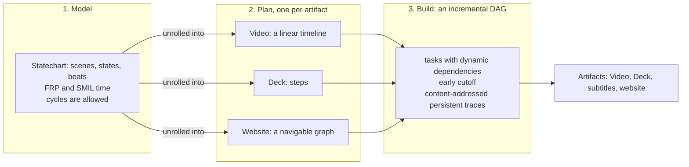

# How reebeat works

Status: design note. Date: 2026-10-29. Spec: [0011](../specs/0011-positioning.md). Decided by: the operator, 2026-10-29 (the technical framing, the three layers and the novelty claim).

The [README](../../README.md) says **what** reebeat is for and **why**: declarative multimedia that is accessible, reproducible and rebuilt as you edit. This note says **how**. It links each quality to the mechanism that delivers it, and it says which mechanisms exist today.

In one line: *semantically declared story beats, compiled into multimedia artifacts: statecharts for structure, functional reactive time, and an incremental build graph, written in Effect.*

In one sentence for a reader who does not write code: you declare the story's beats and what they mean; reebeat derives motion, timing and every artifact, reproducibly, and rebuilds only what an edit changes.

## From quality to mechanism

| Quality | Mechanism | Status |
| --- | --- | --- |
| Declarative scenes and transitions | A statechart: scenes and states are the nodes, beats are the transitions. The motion between two states comes from matching the same element id in both (the identity diff) | Scenes, ids and the identity diff are real ([spec 0001](../specs/0001-release-1-screenplay-to-deck-and-video.md), [0002](../specs/0002-explicit-anchors-and-syntax.md)). The declared machines are built in [spec 0004](https://github.com/reebeat/reebeat/pull/17) (PR #17, open). reebeat's own transition generation is spec 0005 (being planned) |
| Accessibility | One source with meaning in it. Each artifact is a derived view of the model, so a caption track, an audio description or a reduced-motion variant is another derived view | Subtitles, speaker notes and chapters are real. The rest is roadmap ([#12](https://github.com/reebeat/reebeat/issues/12)) |
| Reproducibility | Time is a pure function of the frame. Inputs are content-addressed. Nothing reads a wall clock | Real, measured on one machine: F6 of spec 0001 |
| Fast, incremental rebuilds | An incremental build graph that reuses a result when its inputs have not changed, and stops early when a recomputed result is the same | Roadmap ([#9](https://github.com/reebeat/reebeat/issues/9)). Today only speech is cached |
| Interaction | Viewer events drive the same transitions that time drives in a video | Roadmap: a website artifact ([#19](https://github.com/reebeat/reebeat/issues/19)); interactive lessons are a deferred investigation ([#20](https://github.com/reebeat/reebeat/issues/20)) |

## The three layers

Each layer has one job.

### 1. The Model: a statechart with time

The Model says what the story is. It has two parts.

**Structure is a statechart.** Harel's statecharts add nesting and parallel regions to state machines ([Harel, 1987](https://doi.org/10.1016/0167-6423(87)90035-9)). A parent state holds child states, and only one child is active at a time ([XState: parent states](https://stately.ai/docs/parent-states)). A parallel state has regions that are all active at once ([XState: parallel states](https://stately.ai/docs/parallel-states)). reebeat uses both: a Scene is a parent state, and each Element has parallel regions for its presence, its position and its style ([design R5](keyframe-engine.md), spec 0004). The Model may contain cycles, for example an interactive loop or a repeat. This is why the Model is not called a DAG.

**Time is functional reactive.** Two ideas come from functional reactive animation: behaviours are time-varying values, and events are sets of conditions ([Elliott and Hudak, 1997](https://conal.net/papers/icfp97/)). The paper gives both a denotational semantics, with a proper treatment of real time (same source). SMIL 3.0 gives the timing vocabulary. Its `par`, `seq` and `excl` containers play children in parallel, in order, or one at a time. Its `begin` and `dur` attributes, and events such as a mouse click, decide when things start. Its `endsync="last"` lets a container last as long as its last child ([SMIL 3.0 timing](https://www.w3.org/TR/SMIL3/smil-timing.html)). reebeat's `last`, `first`, `each` and `until` follow these meanings, and the progress of a transition is a behaviour ([design R5](keyframe-engine.md)).

reebeat owns its schema: a JSON format, defined with Effect Schema, that holds a chosen subset of the SMIL, SCXML and FRP constructs. [Spec 0007](../specs/0007-scxml-persistent-ir-spike.md) records the choice. SCXML stays an artifact format and is not the stored form.

### 2. The Plan: one unrolling per artifact

A Plan is what a reviewer reads before anything is rendered (`reebeat plan`). The Plan unrolls the Model for one artifact:

- For a **Video** the Plan is a linear timeline. Every effect has a frame.
- For a **Deck** the Plan is a list of steps, one per slide or fragment.
- For a **website** the Plan is a graph that the viewer navigates. This artifact is roadmap ([#19](https://github.com/reebeat/reebeat/issues/19)).

The first two exist today. The third needs the cycles that the Model allows, which is why it comes after the work on the Model.

### 3. The Build: an incremental DAG

The Build decides what to run and what to reuse. Here, and only here, reebeat uses the word DAG: the build graph has no cycles.

The design follows *Build Systems à la Carte* ([Mokhov, Mitchell and Peyton Jones, ICFP 2018](https://doi.org/10.1145/3236774)). The paper separates the part that schedules tasks from the part that decides whether a task must run again ([paper](https://www.microsoft.com/en-us/research/wp-content/uploads/2018/03/build-systems.pdf)). Three properties matter here:

- **Dynamic dependencies.** A task can find out what it depends on while it runs. The paper says that a monadic task allows this (same paper).
- **Early cutoff.** When a task is run again and its result is unchanged, the tasks that depend on it need not run (same paper).
- **Persistent traces.** The paper names "verifying traces" and "constructive traces" as the stored records that systems use to decide this (same paper). reebeat plans content-addressed traces: the key of a result is a hash of its inputs.

Salsa, a Rust framework for incremental computation, is the closest practical neighbour. It memoises function results and reuses them when the inputs have not changed ([Salsa](https://salsa-rs.github.io/salsa/overview.html)). When an input changes but a recomputed output does not, Salsa "backdates" the result so that callers do not recompute ([Salsa: algorithm](https://salsa-rs.github.io/salsa/reference/algorithm.html)).

What exists today: the speech cache is content-addressed. Its key is `assetKey`, a SHA-256 of the adapter id, its settings and its input ([AGENTS.md](../../AGENTS.md)). Every edit still rebuilds the whole timeline and the render. The graph is roadmap ([#9](https://github.com/reebeat/reebeat/issues/9)), and a cached build must still be byte-identical to a cold one (F6).

## The role of Effect and XState

**Effect** is the language of the program. It gives typed errors, services and resource safety ([Effect v4](https://effect.website/docs/v4/onboarding)). A service is declared as a requirement in a function's type ([services](https://effect.website/docs/v4/requirements-management/services)). A resource that is acquired is released when its scope closes ([scope](https://effect.website/docs/v3/resource-management/scope)). Effect Schema validates and transforms data ([Schema](https://effect.website/docs/v4/schema/introduction)). In reebeat the seven services (`SpeechSynthesizer`, `WordAligner`, `SoundLibrary`, `Renderer`, `FrameCapturer`, `Encoder`, `AssetCache`) are the seams where outside tools plug in ([AGENTS.md](../../AGENTS.md)). The Schema defines the IR.

**XState** interprets the statechart at build time. It has pure functions, `initialTransition` and `transition`, that compute the next state and actions outside a running actor ([XState: machines](https://stately.ai/docs/machines)). Because reebeat's runtime is a build step, a pure function is what it needs. The spike of spec 0007 ran XState v6 alpha as the interpreter: 20 of 20 runs gave byte-equal logs, in 29 ms for the 55 s story. It recommends the pure API behind a `StatechartInterpreter` service in an integration package, and not `@xstate/effect`. The operator decided that an experimental dependency is pinned exactly and that its types stay out of the public API. XState is **not** a dependency of the repository today. The XState docs that were read describe v5, and they say nothing about v6 or `@xstate/effect` ([XState docs](https://stately.ai/docs)).

## Authoring tools and interaction tools

Two kinds of tool touch a story, and they touch different things.

- **Authoring tools** act on the creational format: the Fountain file and the IR. An editor, a script or an agent that changes the story is an authoring tool.
- **Interaction tools** act on a produced artifact: a viewer who clicks, or an agent that drives a page.

An interaction is another element that can trigger events. What differs is when the interaction is realised:

| Artifact | Interface | Interactions are realised |
| --- | --- | --- |
| Video | static | at build time, for example an explicitly visible cursor that clicks |
| Deck | static or stepped | at build time, as beats inside a scene |
| Website | dynamic | at view time, by viewer events that drive the transitions |

This is the direction decided by the operator on 2026-10-29. Only the Video and the Deck exist. The website is roadmap ([#19](https://github.com/reebeat/reebeat/issues/19)).

## Prior art, and what is new

| Idea | Source | What reebeat takes |
| --- | --- | --- |
| Statecharts | [Harel, 1987](https://doi.org/10.1016/0167-6423(87)90035-9) | Nesting and parallel regions for scenes and elements |
| Declarative timing | [SMIL 3.0 timing](https://www.w3.org/TR/SMIL3/smil-timing.html) | Time containers, `begin`, `dur`, `endsync`, event-based timing |
| Behaviours and events | [Fran, Elliott and Hudak, 1997](https://conal.net/papers/icfp97/) | The split between a time-varying value and an event |
| Incremental builds | [Build Systems à la Carte, 2018](https://doi.org/10.1145/3236774) | Dynamic dependencies, early cutoff, persistent traces |
| Incremental computation in code | [Salsa](https://salsa-rs.github.io/salsa/) | Memoised queries and backdating, as a reference design |
| Statechart interpreter | [XState](https://stately.ai/docs/machines) | Pure transition functions at build time |
| Typed services and schemas | [Effect](https://effect.website/docs/v4/onboarding) | The program language |
| Matching by identity | [Keynote, PowerPoint, reveal.js](positioning.md#prior-art-for-the-identity-diff) | Motion from the same element in two states |

**The novelty claim is small and exact.** Each part is prior art. The combination, applied to multimedia, is new. The build engine may be designed in a generic way, but reebeat claims it only for multimedia, until it is proven elsewhere.

## Considered and rejected: React's core as the compiler

React's reconciler and scheduler were considered as the core of the compiler. They were rejected. The reasons come in two groups.

**What the React documentation says.**

- A key identifies an item among its siblings in a list ([React: rendering lists](https://react.dev/learn/rendering-lists)). reebeat needs one id to mean one entity across all Scenes of a Story. The scope of a React key is smaller.
- The reconciler is the package for custom renderers, and it describes one host tree through a host configuration ([react-reconciler](https://github.com/facebook/react/tree/main/packages/react-reconciler)). reebeat needs one Model that produces several artifacts, each with its own Plan.
- The scheduler is for cooperative scheduling in a browser environment ([scheduler](https://github.com/facebook/react/tree/main/packages/scheduler)). reebeat's time must be exact and independent of the machine, because F6 compares builds frame by frame.
- React assumes that components are pure functions ([Keeping components pure](https://react.dev/learn/keeping-components-pure)). This fits reebeat's frame function. It does not give a plan over the whole timeline.

**reebeat's own judgement.** React does not plan across all of time before it renders. Its incrementality lives in one process and is lost when the process ends, while reebeat needs traces that persist between builds. React has no model of audio or narration, and in reebeat narration decides the timing of the picture. These three points are the reasons of the design, not claims about React.

**Where React may still fit.**

- As a **render engine**. Remotion does this: it gives a frame number and a blank canvas, and the author renders anything with React ([Remotion](https://www.remotion.dev/docs/idea)). reebeat can add such an engine as a `Renderer` adapter. Several engines per scene are a stated goal.
- As an **authoring importer**. JSX can be a way to write the IR, like the Fountain importer that exists today.

## Built today, and planned

| Part | Status | Where |
| --- | --- | --- |
| Screenplay to Plan, Deck and Video, with explicit anchors | Real | specs [0001](../specs/0001-release-1-screenplay-to-deck-and-video.md), [0002](../specs/0002-explicit-anchors-and-syntax.md) |
| Byte-identical builds on one machine | Real | F6, spec 0001 |
| Seven services with contracts and offline stand-ins; Effect Schema for the manifest | Real | [AGENTS.md](../../AGENTS.md) |
| Declared machines, the IR, the timing combinators | Built on a branch, in review | [spec 0004](https://github.com/reebeat/reebeat/pull/17) (PR #17) |
| Verdict on the persistent format, and the construct catalogue | Written | [spec 0007](../specs/0007-scxml-persistent-ir-spike.md) |
| reebeat's own transitions, curves, a closed expression language | Being planned | spec 0005 |
| XState as the build-time interpreter | Recommended, not a dependency | spec 0007 |
| Extension architecture (adapters and plugins) | Being written | spec 0012 (in progress) |
| Incremental build graph with early cutoff and persistent traces | Roadmap | [#9](https://github.com/reebeat/reebeat/issues/9) |
| Captions with sound descriptions, audio description, reduced motion | Roadmap | [#12](https://github.com/reebeat/reebeat/issues/12) |
| Interactive website artifact | Roadmap | [#19](https://github.com/reebeat/reebeat/issues/19) |
| Interactive lessons | Deferred investigation | [#20](https://github.com/reebeat/reebeat/issues/20) |
| A model with cycles; a Plan that is a graph | Roadmap, with the website | [#19](https://github.com/reebeat/reebeat/issues/19) |

How reebeat differs from other tools, and when not to use it: [positioning.md](positioning.md).

## Sources

All were read on 2026-10-29.

- Harel, D. (1987). Statecharts: a visual formalism for complex systems. *Science of Computer Programming* 8(3), 231 to 274. DOI [10.1016/0167-6423(87)90035-9](https://doi.org/10.1016/0167-6423(87)90035-9). Only the citation was checked; the note does not quote the paper.
- [SMIL 3.0 Timing and Synchronization](https://www.w3.org/TR/SMIL3/smil-timing.html), W3C.
- Elliott, C. and Hudak, P. (1997). Functional reactive animation. ICFP. [Author's page](https://conal.net/papers/icfp97/); [ACM](https://dl.acm.org/doi/10.1145/258948.258973).
- Mokhov, A., Mitchell, N. and Peyton Jones, S. (2018). Build Systems à la Carte. *Proc. ACM Program. Lang.* 2 (ICFP), article 79. DOI [10.1145/3236774](https://doi.org/10.1145/3236774); [PDF](https://www.microsoft.com/en-us/research/wp-content/uploads/2018/03/build-systems.pdf).
- Salsa: [overview](https://salsa-rs.github.io/salsa/overview.html), [algorithm](https://salsa-rs.github.io/salsa/reference/algorithm.html).
- XState: [docs](https://stately.ai/docs), [machines](https://stately.ai/docs/machines), [parent states](https://stately.ai/docs/parent-states), [parallel states](https://stately.ai/docs/parallel-states).
- Effect: [onboarding](https://effect.website/docs/v4/onboarding), [services](https://effect.website/docs/v4/requirements-management/services), [scope](https://effect.website/docs/v3/resource-management/scope), [Schema](https://effect.website/docs/v4/schema/introduction).
- React: [rendering lists](https://react.dev/learn/rendering-lists), [keeping components pure](https://react.dev/learn/keeping-components-pure), [react-reconciler](https://github.com/facebook/react/tree/main/packages/react-reconciler), [scheduler](https://github.com/facebook/react/tree/main/packages/scheduler).
- [Remotion: the idea](https://www.remotion.dev/docs/idea).
- [GitHub: Mermaid diagrams in Markdown](https://docs.github.com/en/get-started/writing-on-github/working-with-advanced-formatting/creating-diagrams).
- In this repository: [spec 0001](../specs/0001-release-1-screenplay-to-deck-and-video.md), [spec 0002](../specs/0002-explicit-anchors-and-syntax.md), [spec 0007](../specs/0007-scxml-persistent-ir-spike.md), [spec 0004, PR #17](https://github.com/reebeat/reebeat/pull/17), [design](keyframe-engine.md), issues [#9](https://github.com/reebeat/reebeat/issues/9), [#12](https://github.com/reebeat/reebeat/issues/12), [#19](https://github.com/reebeat/reebeat/issues/19), [#20](https://github.com/reebeat/reebeat/issues/20).
