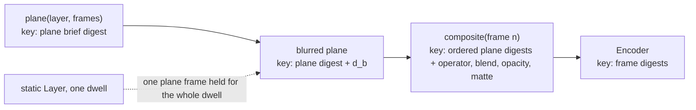

# 0013 Layering: depth, camera, blend and focus for 2.5D States

Status: **plan, design only: nothing in this spec is built** (frozen when its PR opens; revisions are dated entries at the end). Date: 2026-10-29. Decided by: the operator approved **one** decision on 2026-10-29: layering is **2.5D, with one scalar depth per Layer** (Decision 1). The operator also gave the idea (a State holds Layers, blended, with focus pulls and depth moves between States, and capabilities that follow from whether a Layer is static or dynamic). Every other decision below is **Proposed**, for the operator's later review.
Process: [spec 0000](0000-development-lifecycle.md). Number 0013 because the lead assigned the numbers on 2026-10-29 (0004 to 0006 state machines, 0009 npm, 0011 positioning, 0012 extensions). Branch `docs/layering`, named by the lead (the convention is `feat/NNNN-<slug>`); it carries documentation only, like [0012](0012-extension-architecture.md).
Builds on: the extension record, merged to `main` as `82ee66f` ([ADR-0000](../decisions/0000-extension-architecture.md) and [spec 0012](0012-extension-architecture.md)): the engine protocol, capabilities and the compositor "later". Spec 0004, States, Beats and machines, merged to `main` as `53782eb` ([spec 0004](0004-explicit-state-machines-and-timing-combinators.md)). Also on a pull request that is open, so that link goes to the pull request and not to a file on `main`: the positioning note and its words *creating* and *build* ([PR #24](https://github.com/reebeat/reebeat/pull/24), spec 0011). It needs spec 0005 (story-wide identity, curves, exact time), which is not written yet; spec 0004 names it.
Research: [`docs/design/layering-research.md`](../design/layering-research.md). Every claim about another tool below is sourced there.
Verify skill: none, documentation only: it changes no output of `reebeat`; the falsifiers of "Falsifiers of this record" are observed with commands on the committed files.

## Status of every statement

| Statement | Status |
| --- | --- |
| Layering is 2.5D: each Layer has **one scalar depth**, seen through a 2D camera (parallax). Nothing more is Decided: the camera's parts (pan, zoom, focus, band) and every function below are Proposed. | **Decided** (operator, 2026-10-29) |
| A State holds Layers; Layers are blended by blend functions; the camera moves and focus pulls between States; capabilities follow from static or dynamic Layers. | The operator's **idea**. Its concrete shape below is Proposed. |
| The lead's sketch: identity-bearing Layer with depth, opacity, blend, blur, transform and mask as data; one camera per State; blur from the distance of a Layer's depth to the focus; static Layers as a compositing DAG; dynamic Layers as parallel regions; a plan-time capability check; accessibility rules; a closed blend set; a dependency on 0005. | **Proposed** (a sketch, not an operator decision) |
| Every Decision 2 to 12, the schema sketch, the numeric formulas, the protocol additions, and every section without a Decision number (Goal and Journey, which describe the proposal, Non-goals, Terms, The laws, Capability table, Interaction with 0004 and 0005, Determinism, Engine protocol impact, Build graph and caching, Accessibility, both falsifier lists, Risks, Staged plan; each says so under its heading, and Goal and Journey say so in one line). | **Proposed** |

"Decided" is the operator's word, as in [ADR-0000](../decisions/0000-extension-architecture.md) and its [README](../decisions/README.md) (Proposed means merged and not yet confirmed by the operator). Nothing here is Decided by being written in a spec.

## Goal

*Status: Proposed (a description of the proposal; only the scalar depth with a 2D camera is Decided).*

**A person creating a story declares, for each State, a few Layers at different depths, a 2D camera and a focus. reebeat builds the parallax, the blur and the blends between States as frames that are the same bytes every time.**

```text
   viewer's eye
        |
        |      fog     z = -50   (nearer than the screen plane: moves faster)
        |      actors  z =   0   (the screen plane: the camera pans it 1:1)
        |      hills   z = 100   (moves half as far)
        |      sky     z = 300   (moves a quarter as far)
        v
   one 2D camera: pan (x, y), zoom, focus (a depth) and a focus band
```

What the viewer gets: depth from motion (near Layers pass faster than far ones), attention from focus (what is out of focus is blurred; a focus pull moves the eye), and light from blends (a fog that screens, a flash that differences). What the person creating gets: depth as one number per Layer, a camera and a focus per State, and the Beat between two States moves them. What reebeat guarantees today: two builds of one source on one machine give equal frames ([spec 0001](0001-release-1-screenplay-to-deck-and-video.md), F6). What this design aims at, to be observed by F-B1 once built: the compositing step is defined in integers, so it should give equal bytes for equal inputs on any machine.

Layers are also the natural unit of a render engine: an engine renders one Layer as a transparent plane, and a compositor, which is plain integer arithmetic, puts the planes together. A Layer whose Elements are all non-interactive is **static** and collapses into a compositing DAG that the build can cache. A Layer that holds an interactive Element is **dynamic**, is derived as such, and is a parallel statechart region. The capability check reads that, not a declaration.

### Non-goals

*Status: Proposed. The scope below is a proposal for the operator's review, not a decision.*

- 3D rotation, perspective-correct scaling of a Layer by its depth, a camera that moves in depth (dolly), lights, shadows, a Z-buffer, intersecting planes, deep compositing. The decision of 2026-10-29 is scalar depth; the research shows what the full 3D tools pay for it ([research, After Effects](../design/layering-research.md#adobe-after-effects-and-apple-motion)).
- Interactive Layers. They wait for [issue #19](https://github.com/reebeat/reebeat/issues/19). This spec states the rule that makes a Layer dynamic and what then changes; it does not build it.
- A GPU compositor, linear-light blending, non-separable blend modes, per-Layer effects beyond blur, third-party compositors.
- The grammar of the Screenplay for Layers. It belongs to the grammar spec (stage S2 below); the examples here are illustrative.
- A change to any file of the compiler. This pull request changes only the two documents named in the plan.

## Journey

*Status: Proposed. The story and the numbers are illustrations of the proposal.*

Readers, as in spec 0012:

```text
The operator:                   Status table -> Decision 1 (the approved one) -> Open questions (what to answer)
A person creating a story:      Journey (below) -> The laws (what a number does) -> Accessibility
An engine author:               Decision 8 (planes) -> Engine protocol impact -> clauses P1 to P4
Spec 0004/0005 authors:         Interaction with 0004 and 0005
A reviewer of determinism:      Decision 7 -> Determinism -> F-B1 to F-B3
```

What a story could look like. **This is a sketch of a grammar that does not exist.** The verbs `camera` and `depth` and the `[[layers]]` block are illustrative; the grammar spec decides (Decision 9).

```text
INT. THE FOREST - DAY #sc1#

[[layers
  sky:    depth 300   decorative
  hills:  depth 100
  actors: depth 0
  fog:    depth -50   blend screen   opacity 0.4   decorative
]]

Two hikers stand on a path. {id=hiker1 cell=ml class=box layer=actors}
The ridge ahead. {id=ridge cell=mc class=muted layer=hills}

[[effects
  c1: camera refocus depth 50 band 60                   at scene.start
  c2: camera pan 200,0 over 1.2s                        at word("ridge").start
  c3: camera refocus depth 30 band 70 over 0.8s         at c2.end
  s1: sound whoosh                                      at c2.start
]]
```

Hand-computed from the laws below (perspective `d = 100`, blur slope 0.1 px per depth unit, maximum blur 8 px; not produced by any code):

```text
State 1 (camera x = 0, focus depth 50, band 60)          State 2 (camera x = 200, same focus)
  layer   z    p=d/(d+z)   shift     sigma  box d_b        shift
  sky     300  0.25        0 px      8.0    15             -50 px
  hills   100  0.50        0 px      0      0              -100 px
  actors    0  1.00        0 px      0      0              -200 px
  fog     -50  2.00        0 px      4.0     8             -400 px

State 3 (after c3: focus depth 30, band 70)
  sky sigma 8.0 (d_b 15), hills 0, actors 0, fog sigma 1.0 (d_b 2)
  at the middle of the pull (focus 40, band 65): fog sigma 2.5 (d_b 5)
```

The two text Elements (`hiker1` in `actors`, `ridge` in `hills`) sit inside the focus band at every dwell, as the rule of "Accessibility" requires; the decorative `sky` and `fog` carry the blur. A pull to a depth that left a text Layer outside the band would be rejected at plan time. The camera verb is `refocus`, not `focus`, so that it does not collide with the existing `focus` effect (the ring).

Nobody keyframed any blur. `c2.end` anchors the next camera move, `c2.start` anchors the sound: the Beat's events are generated from machines (Decision 9), the way spec 0004 generates every other anchor.

A build, once the stages exist:

```text
reebeat plan --layers story.fountain     # per State: order, p(z), shift, sigma, box size, operator and blend (no pixels)
reebeat build story.fountain             # engine planes -> compositor -> encoder; the same bytes on a second build
reebeat check story.fountain             # F1 also observes parallax and focus in the written frames
```

## Terms (proposed; not added to `GLOSSARY.md` here)

*Status: Proposed.*

[PR #24](https://github.com/reebeat/reebeat/pull/24) changes `GLOSSARY.md` and is open; the merged state-machine work already redefined **Beat** as the edge between States, which this spec uses and does not conflict with, so this pull request leaves the glossary alone and the implementing specs add these. The merged extension record already has a **Compositor** entry: the piece that makes a Beat between two runs on different engines, from boundary frames. **The layer compositor below is a different job** (blending the planes of one State inside one run), so it takes a distinct name and does not reuse that entry. Note that the glossary lists *layer* under "Avoid" for **Element**, and that `Layer` already names the Effect `Layer` (a service implementation) in this repository; the first implementing spec removes the first and chooses a module name that does not clash with the second.

| Term | Meaning |
| --- | --- |
| **Layer** | An identity-bearing group of Elements in a State that has one depth, an opacity, a blend and a composite operator. Its id is story-wide once 0005 lands. |
| **Depth** | One scalar per Layer per State: larger is farther from the viewer; 0 is the screen plane. |
| **Camera** | One per State: a 2D pan, a zoom, and a focus (a depth, or a Layer whose depth it follows) with a focus band. |
| **Parallax factor** `p(z)` | How far a Layer at depth `z` moves when the camera pans: `d / (d + z)`. |
| **Plane** | The RGBA frames of one Layer, drawn by an engine at the Layer's final transform on a transparent background. |
| **Layer compositor** (written "the compositor" below) | Integer arithmetic that turns planes and per-frame values into RGB frames inside one run. First-party; the CPU version is the reference. Not the seam **Compositor** of ADR-0000 (row 9), which makes a Beat between two runs; the two may share one pure integer library, which the seam Compositor would call to blend boundary frames. |
| **Static / dynamic Layer** | Derived: dynamic when an Element of the Layer declares an interaction; static otherwise. Never written. |

## The laws (what each number does)

*Status: Proposed.*

All values are those of one frame `n`; the Beat's curves have been evaluated at `n` already (spec 0004, 0005). `d` is the story's `perspective` setting; `c = (cx, cy)` the camera pan in pixels of the screen plane; `k` its zoom; `u` a point of a Layer in canvas pixels from the canvas centre.

1. **Parallax.** `p(z) = d / (d + z)`. A Layer is placed at `s = k · (u − p(z) · c)`. At rest (`c = 0`, `k = 1`) every Layer appears as written, whatever its depth; panning shifts the screen plane by `−k·c` and a Layer at depth `z` by `−k·p(z)·c`. `z > −d` is required (a Layer is never behind the eye): a lint error otherwise. The zoom is uniform: a 2D camera does not change the relative parallax; a camera that moves in depth would, and is a non-goal. The form `d/(d−Z)` is the CSS perspective law ([research](../design/layering-research.md#css-filters-3d-transforms-and-parallax-figma)); Nuke's Card3D is the 2.5D precedent but its page gives no formula, and Godot's `scroll_scale` is a per-axis multiplier of the same kind ([research](../design/layering-research.md#unity-and-godot)).
2. **Order.** Layers composite from far to near: sort by depth descending, ties by declaration order. The order is total, so no tie is left to an implementation (Unity and Godot document ties that are not guaranteed).
3. **Focus and blur.** With the camera's focus depth `f` and band `w ≥ 0`, a Layer at depth `z` has `σ(z) = min(σmax, slope · max(0, |z − f| − w))` pixels, where `slope` (pixels per depth unit) and `σmax` are story settings. `blur: off` on a Layer pins `σ = 0`. A focus that names a Layer follows that Layer's depth. The rule is linear, so it needs no function that is not exact.
4. **Box size.** reebeat's blur is three box blurs per axis of integer size `d_b = floor(1.8799712059732503 · σ + 1/2)`; for an even `d_b` the module's rule is two boxes of size `d_b` and one of size `d_b + 1` ([Filter Effects 1, §9.14](https://www.w3.org/TR/filter-effects-1/)); edge pixels are duplicated; a box of `n` samples averages as `floor((2·sum + n) / (2·n))` (half up); `d_b ≤ 1` is no blur. It is **reebeat's own definition**, not a claim of equality with any browser (the module says an approximation "can be used"). `1.8799712059732503` is `3·√(2π)/4` written as a literal, so no run computes it.
5. **Composite.** For each Layer, far to near: blur its plane, multiply its four channels by its opacity, apply its matte, then composite it onto the backdrop with its operator and blend (Decision 6). A Layer that is a group composites its children onto a transparent backdrop first (an isolated group).
6. **Opacity** is an integer `0..65535`; **presence** (a Layer entering or leaving) is an opacity ramp over the Beat window, as Keynote, PowerPoint, reveal.js, Figma and Manim fade what they cannot match ([research, synthesis](../design/layering-research.md#synthesis-adopt-adapt-reject-for-reebeat)).

## Decisions

Each decision has options, a recommendation, and a status. Only Decision 1 is Decided.

## Decision 1: depth is one scalar per Layer (2.5D)

**Status: Decided** (operator, 2026-10-29).

A Layer has one number, its depth, and is a flat plane parallel to the screen: that is what 2.5D means here. This keeps one number driving three effects (parallax, blur, order) and keeps the build free of 3D intersection rules. The operator's decision includes a 2D camera; the parts of that camera (pan, zoom, focus, band) are Decision 3 and are Proposed.

### Alternatives considered

| Option | Why not (or why) |
| --- | --- |
| **A. One scalar depth per Layer, a 2D camera** | **Chosen by the operator.** Nuke names this 2.5D: "you can move an element back on the z axis, but doing so does not convey the sense that it is behind or in front of another element" ([research](../design/layering-research.md#davinci-resolve-fusion-page-and-edit-page-nuke-blender)). |
| B. Full 3D layers and a 3D camera | After Effects and Motion need a per-layer switch, a renderer choice and rules for which layers intersect. Out of the approved scope. |
| C. Painter's order only, no number | Gives no parallax and no focus; Keynote, PowerPoint and reveal.js work this way. |

## Decision 2: where Layers live and how they are matched

**Status: Proposed.**

A State holds the full values of its Layers (depth, opacity) and of its camera, like a Keyframe holds every Element. A Layer declares its constants once (blend, operator, blur, matte, parent, decorative). Each Element is in exactly one Layer; an Element with no `layer` is in the implicit Layer `base` (depth 0, normal, opacity 1), so a story written before this spec builds the same frames (F-B3). Layers are identity-bearing: **the same Layer id in two States is the same Layer**, and the identity diff of spec 0004 runs on Layers as it runs on Elements (enter, exit, same, update). With story-wide identity (0005) a Layer id persists until a State drops it.

### Alternatives considered

| Option | Why not (or why) |
| --- | --- |
| **A. Full values per State, constants once, matched by id** | **Recommended.** Same shape as Elements, so the machines and the diff are reused. Figma, PowerPoint, reveal.js and Keynote match by identity and dissolve the unmatched; the dissolve here is the presence ramp. |
| B. Match by name and hierarchy (Figma) | A second matching rule beside the id rule. Rejected. |
| C. Allow an Element to change Layer between States | Two planes would hold one entity during the Beat. **Refused in v1**: it is an error `layer/reparent`; an Element that must change Layer is two ids. Open question 4. |

## Decision 3: the camera and the parallax law

**Status: Proposed.**

The camera is data of the State: `x`, `y`, `zoom`, `focus`, `band`. The Beat moves it. The law is "The laws", 1 and 2: the flat parallax `p(z) = d/(d+z)` without scaling a Layer by its depth.

### Alternatives considered

| Option | Why not (or why) |
| --- | --- |
| **A. Flat parallax: shift by `p(z)`, no depth scaling, uniform zoom** | **Recommended.** A Layer looks as written at rest, so a creator draws a hill at the size it should have on screen. Godot's `Parallax2D` works this way. |
| B. Perspective-correct: scale a Layer by `p(z)` as CSS and After Effects do | A far Layer shrinks, so the creator draws it larger by `1/p`; the classic CSS parallax article needs that correction by hand ([research](../design/layering-research.md#css-filters-3d-transforms-and-parallax-figma)). Cost: two numbers to keep consistent. |
| C. A depth-moving camera (dolly) | Relative parallax changes with zoom; needs a 3D camera. Non-goal. |

## Decision 4: order and ties

**Status: Proposed.**

The order is the depth order, far first, ties by declaration order ("The laws", 2).

### Alternatives considered

| Option | Why not (or why) |
| --- | --- |
| **A. Depth order; ties by declaration** | **Recommended.** One number; total. A Beat that changes the relative depth of two Layers swaps them at the frame where the order changes, which can pop; a plan-time diagnostic `layer/crossing` names it when either Layer has a blend other than `normal` or an operator other than `over`. |
| B. An explicit `order`, independent of depth (Godot `CanvasLayer.layer`, After Effects' 2D stack) | A second number that can disagree with the depth. A Layer's parallax and its stacking could then contradict. |
| C. Order by depth, resolved per pixel (Blender's Depth Combine) | Needs a depth channel in every plane; non-goal at scalar depth. |

## Decision 5: focus and blur

**Status: Proposed.**

Blur is derived each frame from the Layer's depth and the camera's focus ("The laws", 3 and 4); nobody keyframes it. Moving the focus, or a Layer's depth, is the focus pull.

### Alternatives considered

| Option | Why not (or why) |
| --- | --- |
| **A. A linear rule with a band and a clamp; reebeat's integer box recipe** | **Recommended.** Fusion's Depth Blur and Nuke's ZDefocus use a focal point, a band and a size; Unity's Gaussian mode a start, an end and a maximum (those pages give no law between the parameters). The rule here is linear, needs no transcendental function, and uses only integers and correctly rounded binary64 `+ − · /`; the slope is stored as an integer count of thousandths. |
| B. A physical lens (focal length, f-stop, aperture) | After Effects, Blender and Unity Bokeh; none of the pages read gives the radius formula, and the Unity URP and HDRP pages read word the aperture in opposite directions ([research](../design/layering-research.md#unity-and-godot)). |
| C. Call the browser's `blur()` | Allowed to differ between implementations by the module's own words. |
| D. A Gaussian with exact weights | Needs `exp`, and ECMA-262 says the behaviour of `exp`, `pow`, `sin` and others "is not precisely specified here" ([ECMA-262](https://tc39.es/ecma262/)), so two engines may differ. |

## Decision 6: blend and composite, a closed set

**Status: Proposed.**

Two orthogonal fields, in W3C's order: the **blend** (colour) first, then the **operator** (coverage, Porter and Duff). The set is closed; a story cannot add a mode. Every mode in it has a premultiplied form that needs **no division**, and that is the rule for admitting a mode.

| Field | v1 values |
| --- | --- |
| `operator` | `over` (default), `in`, `out`, `atop`, `xor`, `plus` |
| `blend` | `normal` (default), `multiply`, `screen`, `darken`, `lighten`, `difference`, `exclusion` |

A Layer's `matte` takes its coverage from another Layer's alpha (Porter and Duff `in`, or `out` for the inverted mode) before the Layer meets the backdrop; `operator` is how the Layer then meets the backdrop. The "set overlap" of the operator's idea is `operator`, the "difference" is `blend: difference`. With `αs`, `αb` the source and backdrop alphas, `cs`, `cb` the premultiplied colours, `Fa`, `Fb` the operator factors ([W3C Compositing 1](https://www.w3.org/TR/compositing-1/), §9.1: `over`: `Fa = 1`, `Fb = 1 − αs`; `in`: `αb`, `0`; `out`: `1 − αb`, `0`; `atop`: `αb`, `1 − αs`; `xor`: `1 − αb`, `1 − αs`; `plus`: `1`, `1`):

```text
X  = (1 − αb)·cs + P                         P is the blend term below; for `normal`, X = cs
co = Fa·X + Fb·cb          ao = Fa·αs + Fb·αb          (all in 0..1, clamped; plus clamps at 1)

P (blend term, per colour channel, division-free in premultiplied form)
  multiply    cs·cb
  screen      αs·cb + αb·cs − cs·cb
  darken      min(αs·cb, αb·cs)
  lighten     max(αs·cb, αb·cs)
  difference  |αs·cb − αb·cs|
  exclusion   αs·cb + αb·cs − 2·cs·cb
```

This is [W3C's general form](https://www.w3.org/TR/compositing-1/) `Co = αs·Fa·Cs' + αb·Fb·Cb` with `Cs' = (1 − αb)·Cs + αb·B(Cb, Cs)`, rewritten with premultiplied colours `c = α·C`. The spec says "The blending calculations must not use pre-multiplied color values"; the rewriting removes the need to unpremultiply for these modes: every `α·α·B` term becomes a product of premultiplied values. Colour-dodge and burn (a division), soft-light (a square root), and hue, saturation, colour and luminosity (they need the unpremultiplied colour) are **out of the set**. `hard-light` and `overlay` have a division-free form too: a comparison selects between two of the forms above, `2·cs ≤ αs` for `hard-light` and `2·cb ≤ αb` for `overlay` (which W3C defines as `hard-light` with the two colours swapped). They are deferred to keep v1 small, not for a reason of principle.

**Evidence behind this (throwaway scripts of 2026-10-29, not committed; their text is in the PR body):** the rewritten forms were compared with the W3C unpremultiplied formulas, in exact rational arithmetic, over every combination of the 9 values `{0, 1/8, ..., 1}` for `αs`, `αb`, `Cs` and `Cb`, for 9 blend modes (the 7 above plus `hard-light` and `overlay`) and 6 operators: 354,294 combinations, **0 mismatches** (`python3 /tmp/layering-verify.py`). **Integer error.** Each `mul` rounds to the nearest unit of 1/65535, so its error is at most 0.5. Following the formulas of this section, the error of the colour channel is at most 1.0 for `normal`, 2.0 for `multiply`, `darken` and `lighten`, 2.5 for `difference`, 3.0 for `screen` and 3.5 for `exclusion` (the blend term `P` has 0.5 per `mul`, counted twice for `exclusion`'s `2·mul`; `X = mul(1−αb, cs) + P` adds 0.5; the final `mul(Fa, X)` adds 0.5 and passes `X`'s error on at a factor of at most 1; `mul(Fb, cb)` adds 0.5); the alpha channel's error is at most 1.0; clamping to `0..M` never increases an error. Observed maxima, by random search with hill-climbing over the four inputs for each blend and operator (`python3 /tmp/layering-err.py`, seed 11): `normal` 0.998, `multiply` 1.885, `screen` 1.454, `darken` 1.484, `lighten` 1.486, `difference` 1.946, `exclusion` 1.990, alpha 0.998; a point found in review, `exclusion`, `in`, `cs=18031, αs=65534, cb=34116, αb=65534`, gives 1.930. The observed values are below the bounds, as they must be; the bounds, not the observations, are what F-B2 uses. `hard-light` and `overlay` have a larger bound (more `mul` terms) and are not in v1.

### Alternatives considered

| Option | Why not (or why) |
| --- | --- |
| **A. The closed division-free set above, blend then operator** | **Recommended.** Two knobs as in Fusion's Merge and Blender's Alpha Over beside Mix; exact integer arithmetic; no unpremultiply. |
| B. The full W3C list including the non-separable modes | Needs unpremultiplied colour, a luminosity function and a clip step; the spec leaves their rounding open. Later. |
| C. An open set (a plugin may add a mode) | A mode with different rounding breaks byte-equality. The set is closed until the compositor has a conformance suite (Decision 8). |
| D. A single list of "blend modes" with operators mixed in (After Effects) | Two different mathematical things in one list; "You can't directly animate blending modes" there. |

## Decision 7: the numbers (bit depth, colour space, rounding)

**Status: Proposed.**

Premultiplied RGBA, **unsigned 16-bit integers**, in the **sRGB-encoded** values the engines write (the encoded values are blended and blurred directly, as CSS filter functions do: "must operate in the sRGB color space"). `M = 65535`; `mul(a, b) = floor((2·a·b + M) / (2·M))`, the product rounded half up. Input: `v16 = v8 · 257` (exact); premultiply `cs = mul(c16, a16)`. Output: `v8 = floor((2·v16 + 257) / 514)`, the nearest 8-bit value. The evaluation order of every formula is fixed by the implementing spec and given with literal test vectors; each `Fa`, `Fb` is an integer in `0..M`. Negative intermediate results are clamped to 0 and results to `M`. The floating-point arithmetic that remains (the parallax factor and the blur size) uses only `+`, `−`, `·`, `/` on IEEE binary64 numbers, each correctly rounded, and no `Math` function ([ECMA-262](https://tc39.es/ecma262/) leaves `sin`, `exp`, `pow` and others to the implementation); the implementing spec quantises each value that reaches an engine or the compositor (the values file, Decision 8) and says how.

Why 16 bits: this record has no measurement of eight-bit rounding, so the choice rests on the cited warnings. Porter and Duff note that precision "falls off sharply" as alpha approaches 0; After Effects says GPU-accelerated effects "may render with small color precision differences in an 8-bpc project" against CPU rendering and advises 16 or 32 bits per channel for accurate results; Blender stores data in half precision by default, and its Auto setting uses full precision for final renders ([research](../design/layering-research.md#adobe-after-effects-and-apple-motion)). The cost is memory: a 1280 by 720 plane is 7.4 MB.

### Alternatives considered

| Option | Why not (or why) |
| --- | --- |
| **A. 16-bit premultiplied integers, sRGB-encoded** | **Recommended.** Exact, fast on a CPU, equal on every machine for equal inputs. |
| B. 8-bit premultiplied integers | Smaller; rounding error of several 8-bit units after a few Layers and a blur (not measured here). |
| C. 32-bit float, linear light (Fusion, Nuke) | Physically better for blur and `plus`; needs a transfer function (`pow`) that is not exact, or a lookup table built once and fixed. Later, behind a setting. |
| D. A GPU path | Fusion's own manual says its OpenGL output "may vary slightly from system to system" ([research](../design/layering-research.md#davinci-resolve-fusion-page-and-edit-page-nuke-blender)). A GPU compositor may exist later if it equals the reference byte for byte (Decision 8, clause C1). |

## Decision 8: planes, and the engine protocol

**Status: Proposed.**

An engine renders a **plane** per Layer: RGBA frames of the Layer's Elements alone, on a transparent background, **drawn at the Layer's final transform** for each frame. The compositor never resamples, so it needs no resampling filter in its specification. The host writes the per-frame transform of each plane into the `values` file that ADR-0000 defines for sampled engines. Detail in "Engine protocol impact".

### Alternatives considered

| Option | Why not (or why) |
| --- | --- |
| **A. The engine rasterises each plane at its final transform; the compositor only blends and blurs** | **Recommended.** Crisp text at every depth and zoom; the compositor stays integer-only. Cost: a moving camera re-renders every plane at every frame of the Beat (not measured). |
| B. The engine renders each plane once; the compositor scales and moves it | Cheap. Needs a resampling filter in the specification, softens text, and rounds sub-pixel positions. |
| C. Per-Layer engines (one Layer by Manim, one by reveal) | The natural reading of "a Layer is the unit of an engine". It changes the "run" of ADR-0000 from a stretch of Scenes to a set of Layers. The planes protocol allows it; **deferred** (Open question 9). |

The **layer compositor** is not row 9 of ADR-0000 (the seam **Compositor**, "later": it makes a Beat between two runs); it is a new row, `LayerCompositor`: its **mathematics** a first-party **library** now (pure functions over typed arrays, a plain function by the repository rule that frame math stays plain), and its **service** (a swappable, possibly GPU or third-party implementation) later, with the clause C1: it must equal the reference for every input, byte for byte. Adding the row is a dated Revision to ADR-0000 (stage S1).

## Decision 9: States, Beats and machines

**Status: Proposed.**

No new hook mechanism. Layers and the camera add **machines** (spec 0004's term), and the anchors for them are generated like every other anchor. A Beat between two States is the window over which the differing camera and Layer values interpolate (by the curves of 0005; the default is the renderer's declared easing, as for `move` today). An effect subscribes to these events with the combinators of 0004. Creating a depth move or a focus pull is declaring the next State's value.

| Machine | Subject | States | Transitions (window = the Beat's) | Source of the edge |
| --- | --- | --- | --- | --- |
| `layer-presence` | a Layer: `<id>` | `absent`, `entering`, `present`, `exiting` | `enter`, `exit` | identity diff of Layer ids between States |
| `layer-depth` | a Layer: `<id>` | `settled`, `shifting` | `shift` | the Layer's depth differs between States |
| `camera-pan` | `camera` | `still`, `panning` | `pan` | `x`, `y` or `zoom` differ |
| `camera-focus` | `camera` | `sharp`, `pulling` | `refocus` | `focus` or `band` differs |

From these, `hills.shift.end`, `camera.pan.start`, `camera.refocus.50%` and `when(camera.pan.progress >= 50%)` exist, and `hills.slide.end` is a lint error with "did you mean" (0004 F2). `camera` becomes a reserved id. The creating surface (stage S2) writes a change as sugar; the verbs `camera` and `depth` in the journey are such sugar and compile to full State values, the way the design says `reveal`, `hide`, `morph` and `focus` "become sugar that compiles to Beats" ([keyframe-engine design, section 0](../design/keyframe-engine.md)).

### Alternatives considered

| Option | Why not (or why) |
| --- | --- |
| **A. Machines generate the events; State values are full; the Beat interpolates** | **Recommended.** Reuses 0004's F2: the vocabulary is the machines. |
| B. Hand-written "lifecycle hooks" (`onShift`, `onFocus`) | A second vocabulary beside the generated one; the failure 0004 exists to remove. |
| C. Store only the change (a delta), not full values | The IR would store a derived fact (0004: "the IR stores no derived fact"). |

## Decision 10: static and dynamic Layers are derived

**Status: Proposed.**

`dynamic(layer) = some Element of the layer declares an interaction`; otherwise static. There is no `dynamic` key: the closed schema rejects it (a field that can disagree with its content is a representable illegal state). Today no Element can declare an interaction, so every Layer is static; the rule and its consequences are specified so that spec 0012's artifact capabilities (`kind: static | dynamic`) can read it when [issue #19](https://github.com/reebeat/reebeat/issues/19) lands. See "Capability table".

### Alternatives considered

| Option | Why not (or why) |
| --- | --- |
| **A. Derived from the Elements' interactions** | **Recommended.** One source of truth: the Element. |
| B. Declared `static` or `dynamic` on the Layer | Can disagree with the Elements; needs a check that the derived answer equals the declared one. |
| C. No distinction; every Layer is treated as dynamic | Gives up the bake: nothing could be cached as a plate. |

## Decision 11: the build graph and caching

**Status: Proposed.**

Layers fit the layering of ADR-0000 ("Layering: the story, the plans and the build graph"): the **story** is a statechart; the **plan of the video** unrolls it into a timeline; the **build graph** is a DAG with dynamic dependencies and early cutoff. See "Build graph and caching" for the nodes and what an edit costs.

### Alternatives considered

| Option | Why not (or why) |
| --- | --- |
| **A. One cache node per plane, per blurred plane, per composited frame; keyed by digests** | **Recommended.** An edit to one Layer re-renders one Layer; an edit that leaves a plane's pixels unchanged stops there (early cutoff). |
| B. One cache node per run (ADR-0000's unit today) | Every Layer change re-renders every Layer. |
| C. Cache only the final frames | Loses the cutoff between stages. |

## Decision 12: accessibility is on by default

**Status: Proposed.**

See "Accessibility". Reading order does not come from depth; a `decorative` Layer is declared and carries no text; a non-decorative Element with text must be in focus at every State's dwell; reduced motion has a defined variant.

### Alternatives considered

| Option | Why not (or why) |
| --- | --- |
| **A. On by default, relaxed by a visible line in the configuration (ADR-0000's rule for `accessible`)** | **Recommended.** Same rule as reproducibility. |
| B. Opt-in | A story that nobody checked ships blurred text. |
| C. Leave to the creator's judgment | The rule is computable at plan time from declared numbers, so a check is cheap. |

## Schema sketch (Effect Schema constructs; no implementation)

A sketch, to show the shape; it is not in the repository and no name is binding. It follows `packages/core/src/plan.ts` as spec 0004 leaves it (`Schema.Struct`, `Schema.Int.check(...)`, `construct(...)` annotations with an `origin`; the schema is closed, so an excess key is a decode error). Proposed home: `packages/core/src/layers.ts`.

```ts
import { Schema } from "effect";
import { IdSchema, construct } from "./plan.ts";

/** Thousandths of a depth unit. Larger is farther from the viewer; 0 is the screen plane. z + perspective > 0 is a structure rule. */
export const DepthSchema = Schema.Int;
/** 0..65535: the 16-bit integer of Decision 7. */
export const OpacitySchema = Schema.Int.check(Schema.isBetween({ maximum: 65535, minimum: 0 }));

export const BlendSchema = Schema.Literals(["normal", "multiply", "screen", "darken", "lighten", "difference", "exclusion"]);
export const OperatorSchema = Schema.Literals(["over", "in", "out", "atop", "xor", "plus"]);

/** What a Layer is: its constants. Its depth and opacity are per State (below). */
export const LayerSchema = Schema.Struct({
  blend: BlendSchema,
  blur: Schema.Literals(["auto", "off"]),
  decorative: Schema.Boolean,
  id: IdSchema, // story-wide with spec 0005; `base` is reserved for the implicit Layer
  matte: Schema.NullOr(Schema.Struct({ layer: IdSchema, mode: Schema.Literals(["alpha", "alpha-inverted"]) })),
  operator: OperatorSchema,
  parent: Schema.NullOr(IdSchema), // a Layer that is a group; its children composite in isolation first
}).annotate(
  construct(
    "Layer",
    "Porter and Duff 1984, element and matte; W3C Compositing 1, group and isolation; Harel 1987, orthogonality (a dynamic Layer)",
    "A group of Elements with one depth, drawn as one plane and composited with an operator and a blend.",
    "Depth is one scalar (spec 0013, Decision 1); the blend set is closed and division-free (Decision 6)."
  )
);

/** What a State says about one Layer: full values, never a delta. */
export const StateLayerSchema = Schema.Struct({
  depth: DepthSchema,
  layer: IdSchema,
  opacity: OpacitySchema,
});

export const CameraSchema = Schema.Struct({
  band: Schema.Int.check(Schema.isGreaterThanOrEqualTo(0)), // thousandths of a depth unit
  focus: Schema.Union([Schema.Struct({ depth: DepthSchema }), Schema.Struct({ layer: IdSchema })]),
  x: Schema.Finite, // pixels of the screen plane; exact quantities follow 0005
  y: Schema.Finite,
  zoom: Schema.Finite.check(Schema.isGreaterThan(0)),
}).annotate(construct("Camera", "Nuke Card3D, 2.5D; Godot Parallax2D scroll_scale", "The 2D camera of a State: pan, zoom and focus.", "No depth axis for the camera (Decision 3)."));
```

Additions elsewhere: `ElementSchema.layer: IdSchema` (default `base`, written only when not `base`); `StateSchema.layers: Array<StateLayer>` and `.camera: Camera`; `SettingsSchema.perspective`, `.blurPerDepth` (stored as an integer count of thousandths of a pixel per depth unit, so no decimal fraction is needed) and `.blurMax`; the graph gains `layers: Array<Layer>`. The schema is closed, so these are a new `graphVersion` (Open question 7). There is no `dynamic` key (Decision 10). `validateGraph` gains the rules: Layer ids unique, not reserved (`base`, `camera`) and **disjoint from Element ids, effect ids and `let` names** (they share one namespace in spec 0004, so `hills.enter.end` can name only one thing); every `layer` reference resolves; `depth + perspective > 0`; the `matte` and `parent` references are acyclic; a decorative Layer holds no Element with text; an Element does not change Layer between States.

## Capability table: static and dynamic

*Status: Proposed.*

| | **Static Layer** | **Dynamic Layer** |
| --- | --- | --- |
| Derived from | no Element of the Layer declares an interaction | at least one does ([issue #19](https://github.com/reebeat/reebeat/issues/19): an interaction is an Element) |
| Statechart | not a region: its values are data of the State; its presence and depth are machines (Decision 9) | an orthogonal (parallel) region with its own States, driven by the interaction events (spec 0007: `<parallel>`) |
| Build graph | a pure node of the compositing DAG: baked, cached by digest, a dwell is one node | cannot be baked beyond what the artifact schedules; live in a dynamic artifact |
| Engine need | `planes` (Decision 8) | `planes`, plus `web: bundle` and `semantics` for a dynamic artifact (ADR-0000, Decision 4) |
| Video (a static artifact) | composited into frames | its interaction is realised only as `scheduled` or `described` (ADR-0000, Decision 4); the Layer is drawn in its scheduled States |
| Deck, interactive site (dynamic artifacts) | a baked plate or a stacked, settled Layer | live; a control surface (`step`, `control`, `tool-endpoint`) |
| Plan-time check | `cap/layers-need-planes` when the engine has `planes: none` and a State has more than one Layer | the same, plus the artifact's `interactions` surface must list one the Layer's interaction can use |
| When built | every Layer, until issue #19 lands | none: no Element can declare an interaction yet |

The rule is the derived predicate; the table is what each answer means. The dynamic half is **specified and not built** here.

## Interaction with spec 0004 and spec 0005

*Status: Proposed. Rows that say "required" of spec 0005 are requests to a spec that is not written, not decisions.*

| Construct | Effect of this spec |
| --- | --- |
| State | holds the full values of its Layers and its camera |
| Beat | the window over which they interpolate; a Beat between two States with equal layer values has no layer events |
| Scene (compound State) | owns an identity scope in 0004; **0005 makes identity story-wide**, so Layer ids are story-wide too. Until then a Layer id is unique in its Scene and a Layer does not persist across a Scene boundary |
| Machines and anchors | four new machines (Decision 9); `camera` reserved |
| Identity diff | runs on Layer ids as on Element ids; an Element changing Layer is refused |
| Combinators, `let`, `until` | unchanged: they read the generated events |
| Curves, exact time (0005) | **required**: the Beat's interpolation of depth, opacity, pan, zoom and focus uses 0005's curves and flicks; until 0005 lands, the renderer's declared easing of spec 0004 is the curve |
| Timeline | gains, per frame, the **values** that reach the compositor: order, `p(z)`, shift, `σ`, `d_b`, opacity, operator and blend |
| Plan | `plan --layers` prints them, with no pixels, so feedback arrives before any engine runs |
| SCXML artifact (spec 0007) | static Layers are data on a state (`rb:` attributes); a dynamic Layer is a `<parallel>` region |
| IR | a new `graphVersion`; the old version decodes (no `layers` means the implicit `base`) |

## Determinism

*Status: Proposed.*

- **Within the compositor:** integer arithmetic only (Decision 7), a fixed evaluation order, the closed set of Decision 6, and a defined clamp. The design is that equal input planes and values give equal bytes on **any** machine, which is stronger than F6 ("same machine"); F-B1 checks it on two runs and two runtime versions (and on a second platform if CI has one), and until it runs this is a design claim, not an observation.
- **At the engine:** planes come from an engine, and an engine is deterministic only on one machine and toolchain ([ADR-0000, Decision 7](../decisions/0000-extension-architecture.md)). So the whole build keeps F6's scope: the same machine. The compositor adds no source of difference, and its test needs no engine (F-B1).
- **Blur and parallax values** use IEEE binary64 `+ − · /` only. The ECMAScript clause that leaves `sin`, `exp` and `pow` to the implementation is the reason for the ban. The curves of spec 0005 that feed these laws need the same ban; that is a requirement on 0005, not yet stated there.
- **What the specs read do not give** (bit depth, rounding, blending colour space: W3C Compositing 1) is fixed here, by Decision 7.
- **Conformance:** a GPU or WASM compositor, when one exists, passes the clause C1 over the same vectors. No other implementation is allowed to be "close".

## Engine protocol impact

*Status: Proposed.*

Against [ADR-0000](../decisions/0000-extension-architecture.md), Decision 3 and Decision 4:

| Item | Change |
| --- | --- |
| Capability | `planes: none` (default) or `rgba8`; with `rgba8` the engine states `independent: true` (an Element's plane pixels do not depend on Elements of other Layers) |
| `run/render` request | a `planes` list: Layer id and its Element ids; the `values` file carries each plane's transform per frame (scale, translation), quantised as the implementing spec says |
| `run/render` result | per plane: the frame names and the SHA-256 of each **decoded** frame (as ADR-0000 already requires for frames), so a plane is a cache key |
| Brief digest | a **plane brief** per Layer (its Elements, their values, its transform series); its digest is the plane's cache key |
| `boundary.snapshots: layers` | is the same mechanism: a plane of the carried ids on the boundary frames. The ADR's text should then say so; that is a Revision to ADR-0000, not an edit from this PR |
| Layer compositor (a new ADR-0000 row; row 9 stays the seam Compositor) | math: library, now; service: later (Decision 8) |
| Clauses (proposed names; numbered by the SDK spec) | **P1** a plane rendered alone equals the same Layer's pixels in a render of all Layers; **P2** pixels outside the Layer's Elements have alpha 0; **P3** equal brief gives equal decoded plane frames; **P4** the Element bounds of a plane rendered under a transform equal the transform of the bounds, within half a pixel; **C1** a compositor equals the reference for every vector |
| `reveal` today | a plane could be captured by hiding the other Layers' Elements and taking a screenshot without the default background: Playwright's `omitBackground` "allows capturing screenshots with transparency" ([Playwright](https://playwright.dev/docs/api/class-page)). **[INFERENCE]**: not run here; the theme's own background would have to be transparent |

The 5-clause list is a proposal; the SDK spec ([ADR-0000, "Order of work"](../decisions/0000-extension-architecture.md)) numbers the clauses.

## Build graph and caching

*Status: Proposed.*



- **Static Layer bake.** A Layer whose transform, `σ` and opacity are constant during a State's dwell is one plane frame held for every frame of the dwell. The composite of a dwell in which nothing moves is one node, however long the dwell lasts.
- **Early cutoff.** `run/render` returns the SHA-256 of every decoded plane frame. An edit that re-renders a plane and leaves its pixels unchanged stops there: `composite` and `Encoder` keys are equal, so nothing downstream runs.
- **What an edit costs.** Editing the text of one Layer re-renders that Layer's planes, not the others (ADR-0000's unit today is the run; Decision 8 makes it the Layer). Changing the camera moves every moving plane, so every plane is re-rendered for the frames of the Beat; that is the price of Decision 8, option A. **Not measured.** F-B7 requires the measurement before S3 is accepted.
- **Reproducibility of the cache:** the compositor is a pure function of its keys.

## Accessibility

*Status: Proposed.*

- **Reading order is the declaration order of the Elements of the State**, never the depth or the stacking: a Layer adds no node to the semantics tree an engine reports in `run/describe`. WCAG 1.3.2 requires that "a correct reading sequence can be programmatically determined" when the order affects meaning ([Understanding 1.3.2](https://www.w3.org/WAI/WCAG22/Understanding/meaningful-sequence.html)); depth is a visual order.
- **`decorative`** is declared on a Layer because meaning is not derivable. A decorative Layer's Elements are left out of the reading order and get no accessible name; `validateGraph` rejects text in a decorative Layer. A non-decorative Layer must hold a text or a role-bearing Element, or it is a lint warning.
- **Focus rests on what is read.** At every State's dwell, each Element with text, and each Element that a `focus` effect (the ring of spec 0004) targets while the ring is on, in a non-decorative Layer that is present with opacity above 0, must have `σ = 0`. The rule is computable at plan time from the declared depth, focus and band, so the error `a11y/blurred-text` needs no pixel. Text may be blurred during a Beat, and a ring may be fired during one. The Journey example obeys the rule: its text Layers are inside the band at every dwell.
- **Contrast on the composite.** An opacity below 1, a blend and a blur change the colours behind a text. Contrast of text over the composited backdrop at each State's settled frame is a build-time check (`reebeat check`), on the written frames, like F1. It is **not** a plan-time rule.
- **Reduced motion.** A variant of the build (the `reducedMotion` capability of ADR-0000, [issue #12](https://github.com/reebeat/reebeat/issues/12)): camera pan, zoom, Layer depth moves and focus pulls take their new value at the end of the Beat (a `step`, no interpolation); Layer enter and exit stay as an opacity fade. The reason to include focus pulls: WCAG's definition of *motion animation* "does not include changes of color, blurring, or opacity which do not change the perceived size, shape, or position", and an erratum amends it "to not exclude blurring" ([Understanding 2.3.3](https://www.w3.org/WAI/WCAG22/Understanding/animation-from-interactions.html)). The same page names parallax scrolling as an example. 2.3.3 is about animation triggered by interaction, so a pre-rendered video falls under other criteria; the variant exists because the operator's issue asks for it, and no claim of conformance is made.
- **Flashing.** `difference`, `exclusion` and `plus`, with animated opacity, can change luminance fast. WCAG 2.3.1 limits flashes to three in any one second unless below the flash thresholds ([Understanding 2.3.1](https://www.w3.org/WAI/WCAG22/Understanding/three-flashes-or-below-threshold.html)). **No analyser is designed here** (Risks).

## Falsifiers of this record

*Status: Proposed.*

Each is observed with a command on the head of this branch.

- **F-doc1, every decision has options and a recommendation.** `grep -c '^## Decision [0-9]*:' docs/specs/0013-layering.md` prints 12 and `grep -c '^### Alternatives considered' docs/specs/0013-layering.md` prints 12. Falsified by a missing table. Control: delete one table; the second count prints 11.
- **F-doc2, Proposed is never worded as Decided.** `grep -c '^\*\*Status: Decided' docs/specs/0013-layering.md` prints 1 (Decision 1) and `grep -c '^\*\*Status: Proposed' docs/specs/0013-layering.md` prints 11. Control: change one Proposed to Decided; the counts print 2 and 10.
- **F-doc3, links resolve.** Every relative link points to an existing path, and every external link answers with a success status. The commands and raw output are in the PR body. Control: a link to a file that does not exist is reported by the same command.
- **F-doc4, documentation only.** `git diff --name-only origin/main...HEAD` lists exactly `docs/design/layering-research.md` and `docs/specs/0013-layering.md`. Control: touching `GLOSSARY.md` adds a line.
- **F-doc5, no unsupported "first", "only" or negative claim.** `grep -nE 'the (first|only)|\bunique\b|\bno other\b|comes only|reaches .* only|only (from|through|via)|there is no|Not by id' docs/specs/0013-layering.md docs/design/layering-research.md` lists each use, and each is either a statement about this document's own contents, a quotation of a source, or carries a source. Falsified by a use that is none of these. The list is in the PR body.
- **F-doc6, the vocabulary is the operator's.** The text says *multimedia*, *creating* for the work of people and *build* for what reebeat does; `grep -niE 'multi-?sens|author[i]ng' docs/specs/0013-layering.md docs/design/layering-research.md` finds nothing (the bracket keeps the command from matching itself). Control: add the word; the command finds it.
- **F-doc7, the numbers can be re-derived.** The exact-rational comparison and the integer-error measurement of Decision 6 are throwaway scripts kept in the PR body, not in the repository (committed code is TypeScript); stage S1 writes the exact-rational reference as committed TypeScript and F-B2 re-runs it. Re-running the scripts prints the counts in the spec. Control: swap `screen` for `multiply` in the rewritten form; the comparison reports mismatches.
- **F-doc8, nothing is claimed built.** `grep -niE 'is buil[t]|are buil[t]|implemen[t]ed|we buil[t]' docs/specs/0013-layering.md` finds only negations: the status line ("nothing in this spec is built"), this line quoting it, and "None is built or run here". Falsified by a claim that code exists. Control: add "the compositor is built" to a copy; the command finds a fourth line.
- **F-doc9, the gates pass.** `bun run ready` passes on the head.

## Falsifiers the implementing specs must pass

*Status: Proposed.*

These are the contract for S1 to S4b. Each has a control that **can fail**: a deliberate defect the check must catch. None is built or run here.

| # | Falsifier | Control (must fail) |
| --- | --- | --- |
| F-B1 | **The compositor is equal across runs.** A fixed set of planes and values gives literal expected bytes (a golden table of SHA-256 digests and of every operator and blend on a 4 by 4 grid), the same result on two runs and two runtime versions, and on a second platform if CI has one (the operator's recorded platform is Linux under devenv) | change `mul` to truncate instead of round: the golden fails and names the pair |
| F-B2 | **Reference conformance.** For every operator and each of the seven v1 blends and a sample of inputs (all pairs of `{0, 1, 127, 128, 255}` 8-bit values and random alphas), the integer result differs from the exact rational form of Decision 6 by at most the bound derived in Decision 6 for that blend (1.0, 2.0, 2.0, 2.0, 2.5, 3.0, 3.5 of 65535 for `normal`, `multiply`, `darken`, `lighten`, `difference`, `screen`, `exclusion`; alpha 1.0), and the rewritten forms equal the W3C unpremultiplied formula in exact arithmetic (`hard-light` and `overlay` are not in v1; their bound is derived before they are admitted) | replace `difference`'s absolute value with a signed difference: the exact comparison fails |
| F-B3 | **A story with no Layers builds the same bytes as before.** The implicit `base` Layer path gives frames equal to the build of `main` before layering, for `stories/same-id` (the journey's two-build and F1 to F9 checks pass unchanged) | set the implicit Layer's blend to `plus`: frames differ |
| F-B4 | **The parallax law is seen.** For a camera pan `c` and Layers at three depths, the observed shift of each Layer's edge in the written frames equals `round(p(z)·c)` within one pixel, and the shift of the `z = 0` Layer is `c` | change one Layer's depth by 100 without changing the plan: the observed shift disagrees with the resolved one |
| F-B5 | **Focus is seen and the rule holds.** The blurred plane of a Layer at `σ` equals the reference box recipe byte for byte; `σ = 0` inside the band; `a11y/blurred-text` is raised for a text Element in a Layer with `σ > 0` at a State's dwell and not for one in focus | a story with blurred text at a dwell is accepted: the lint test fails; widen the band in a copy so `σ = 0`: the same story must then pass, so the lint is observed both ways |
| F-B6 | **Order is total.** Two Layers at one depth composite in declaration order; swapping their declaration changes the bytes (so the tie-break is observable); `layer/crossing` is reported for a Beat that swaps two blended Layers | make the sort unstable (a shuffled comparator): the swap test is flaky or fails |
| F-B7 | **The cost is measured.** The build records, for a story with four Layers and a one-second pan at 30 fps, the time and number of plane renders; the number equals Layers × Beat frames, and the result is written in the spec's Revisions before S3 is accepted | leave the Revisions entry out: the acceptance check that reads it fails |
| F-B8 | **Cache and cutoff.** Editing the text of one Layer re-renders only that Layer's planes (counted in `run/render` calls); an edit that leaves a plane's decoded frames unchanged leaves the `composite` and `Encoder` keys equal and runs neither | make a plane's key include the other Layers' text: the count exceeds one |
| F-B9 | **Capability.** A story with two Layers on an engine declaring `planes: none` fails at plan time with `cap/layers-need-planes` naming the engine and the State; one Layer passes | declare `planes: rgba8` without clause P1 passing: `reebeat conform` fails the engine |
| F-B10 | **Reading order ignores depth.** Reversing all depths leaves the reported reading order unchanged; reordering declarations changes it | derive the order from depth: the first assertion fails |
| F-B11 | **Reduced motion.** In the variant, no Layer moves relative to another between a State's first and last frame except by opacity; in the normal build they do | forget one machine (`camera-focus`): blur still animates in the variant |
| F-B12 | **Static and dynamic are derived.** A `dynamic` key on a Layer is a decode error (closed schema); a Layer with an interactive Element reports `dynamic` and one without reports `static`; this falsifier waits for issue #19 | add a `dynamic` field to the schema: the closed-schema test fails |
| F-B13 | **The vocabulary is the machines.** `hills.shift.end` resolves, `hills.slide.end` is a lint error with "did you mean `hills.shift.end`" (0004's F2 extended); `camera` cannot be a Layer id | misspell a machine's transition in a copy: the vocabulary grows and the document changes with no other edit |

## Risks

*Status: Proposed.*

| Risk | Mitigation |
| --- | --- |
| A moving camera re-renders every plane every frame; the cost may be high | F-B7 measures it before S3; the alternative of Decision 8, option B, stays on the table with its cost (resampling filter, softer text) |
| The engine's planes are deterministic only on one machine | The compositor's bytes are designed to be cross-machine (F-B1 checks it); the build's are not; the claim is stated per stage (Determinism) |
| A plane that is not independent (layout in one Layer depends on another) | `independent: true` is a capability and clause P1 tests it; `reveal`'s cell grid is independent per Element today ([INFERENCE], to be checked in S3) |
| The closed blend set frustrates a creator | The set grows by a spec with golden vectors; no mode is added without them |
| Parallax and focus pulls can cause discomfort | Reduced-motion variant (Accessibility); no analyser for flashing yet |
| A big implicit surface: an effects system by another name | Non-goals; every addition (a mode, a verb) goes through a spec |
| The IR schema is closed, so layers are a version bump | Open question 7; the old version decodes |
| 0005 is not written, and Layers depend on its identity and curves | S1 does not depend on 0005; S2 waits for it |
| Perspective setting `d` and units are arbitrary numbers a creator must learn | Defaults in the settings; `plan --layers` shows `p(z)` and the shift for every Layer |
| Colour: blending in sRGB-encoded values is not physically accurate for blur and `plus` | Stated in Decision 7; linear light is an alternative (option C) behind a later setting |
| Flashing from blends is not analysed | Open question 12; WCAG 2.3.1 named as the criterion |

## Open questions for the operator

The five that decide the shape of the build are marked **(key)**.

1. **(key) Who rasterises?** Decision 8: the engine draws each plane at its final transform (crisp, costs a render per plane per frame of a Beat), or the compositor resamples a plane (cheap, needs a resampling filter, softer text). Recommendation: the engine, with F-B7's measurement as the gate.
2. **(key) Order from depth, or an explicit order?** Decision 4 recommends depth with declaration ties. The alternative is a second number for stacking that can disagree with depth.
3. **(key) Flat parallax or perspective-correct scaling?** Decision 3 recommends the flat form (a Layer looks as written at rest). Perspective scaling would make a far Layer smaller and need `1/p` correction by hand.
4. **(key) Colour space and bit depth.** Decision 7 recommends 16-bit integers in sRGB-encoded values. Linear light is more accurate for blur and `plus` but needs a lookup table for the transfer function.
5. **(key) Is the layer compositor's mathematics a first-party library now, with the service later?** It needs a new row in ADR-0000 (row 9, the seam Compositor, stays as it is), which is on `main`; the ADR would need a dated Revision, written by stage S1.
6. May an Element change Layer between States (Decision 2)? Recommendation: refuse in v1.
7. A new `graphVersion` for the closed IR, or an additive optional field (Decision 2, "Schema sketch")?
8. Does the Deck show Layers (stacked, settled camera, CSS blur that need not equal the Video's), or is v1 a Video-only feature? The Deck realisation is deferred until you answer.
9. Per-Layer engines (Decision 8, option C): the direction, not a v1 item.
10. Is `decorative` declared (Decision 12) or derived from "no Element with text"?
11. The Screenplay surface: effect verbs (`camera`, `depth`) and a `[[layers]]` block, or State blocks? Left to the grammar spec (S2).
12. Does the build need a flash analyser before layers with `difference` ship?

## Staged plan

*Status: Proposed.*

Each stage is **its own spec** under the lifecycle ("if a spec needs two PRs, it was two specs"). This spec builds none of them; it fixes the design the stages share. Numbers are assigned when the specs are written. **Prerequisites outside this plan:** steps 1 to 3 of ADR-0000's "Order of work" (the contracts package, the Engine contract, the wire protocol and a first out-of-process engine, with `reveal` becoming an Engine) are unbuilt and unnumbered; S3 cannot start before them.

| Stage | Builds | Depends on | Journey (one felt feature) | Defers |
| --- | --- | --- | --- | --- |
| **S1 layer compositor** | the pure integer compositor: operators, the seven blends, opacity, matte, isolated group, the box blur; golden vectors; the exact-rational reference in TypeScript; the dated Revision to ADR-0000 (a `LayerCompositor` row; the `boundary.snapshots: layers` wording) | nothing (not 0004, not 0005) | a command composes PNG planes and a recipe into one PNG; two runs give one SHA-256 | the IR, any engine, curves |
| **S2 IR, machines, lints** | `Layer`, `StateLayer`, `Camera`, the four machines, validation, `plan --layers` and the timing events, the grammar for Layers, and the plan-time lint `a11y/blurred-text`, which needs no engine (so no later stage can ship blurred text unchecked) | 0004 merged; 0005 (identity, curves) | a story's `plan --layers` prints order, `p(z)`, shift, `σ`, `d_b` per State, with no pixels, and rejects a story with blurred text at a dwell | pixels |
| **S3 planes and the build** | the planes capability, its plan-time lint `cap/layers-need-planes` and clauses P1 to P4, `reveal` plane capture, the compositor in the build, a journey story with three Layers; F1 observes parallax and focus in the frames | S1, S2, and ADR-0000 "Order of work" steps 1 to 3 | `reebeat build` writes a Video with parallax and a focus pull, equal on a second build | cross-engine seams, per-Layer engines |
| **S4a graph** | per-plane cache, static bake, early cutoff | S3 | editing one Layer re-renders one Layer | dynamic Layers |
| **S4b reduced motion** | the reduced-motion variant | S3 | a reduced-motion Video exists in which no Layer moves against another | contrast on the composite (its own spec, a check on written frames), the Deck's settled realisation (Open question 8) |
| **Deferred** | contrast on the composite; dynamic Layers (issue #19); `hard-light`, `overlay`; a GPU or WASM compositor service with clause C1; linear-light; per-Layer engines; a camera in depth; a flash analyser; the Deck realisation | issue #19, a second compositor | | |

## Revisions

Dated entries. A spec is revised only here after its PR opens.

- **2026-10-29, plan written** from the operator's idea and the lead's sketch, against the heads of PR #17 (`8dc4bef`) and PR #24 (`f6fad25`) and `main` at `82ee66f` (which includes the extension record), before any review. Research in [`layering-research.md`](../design/layering-research.md).
- **2026-10-29, round 1 review (RevLayer27, on `540e8a0`): changes requested; fixes applied.** (1) The Journey example now obeys the blurred-text rule (text Layers inside the focus band at every dwell, blur carried by decorative Layers, numbers recomputed), the rule names `focus`-effect targets, and the camera verb is `refocus`. (2) The research note's unsourced absolute claims are rewritten as `not found in the pages read`, and F-doc5's pattern is widened. (3) Quote and paraphrase mismatches fixed in the note (Card3D quote shortened and its formula claim removed, AE Video switch, Blender precision, Godot `Vector2`, Unity aperture wording, the CSS flattening claim marked as the note's own reading, the Manim formula cited to the source file); the claim that the WCAG 2.3.3 page no longer carries the exclusion sentence was re-checked on 2026-10-29 and the sentence is still there, so it stays. (4) The stage plan names ADR-0000 "Order of work" steps 1 to 3 as prerequisites, S4 is split into S4a and S4b, the plan-time accessibility lint moves to S2, and the ADR-0000 Revision belongs to S1. (5) The `overlay` comparison is `2·cb ≤ αb`; F-B2's tolerance is stated for the seven v1 blends. (6) The Decided row quotes the decision as 2.5D with one scalar depth and a 2D camera, and every section without a Decision number says it is Proposed. Also: the layer compositor has its own name and ADR row (it is not the seam Compositor), Layer ids are disjoint from Element ids, the box-blur rounding and the even-size rule are specified, the second-platform requirement of F-B1 is conditional, and the determinism claim is worded as a design aim.
- **2026-10-29, round 2 review (RevLayer27, on `36ccf2f`): changes requested; fixes applied.** (1) `cap/layers-need-planes` moves from S2 to S3 (it needs the `planes` capability and ADR-0000 steps 1 to 3); `a11y/blurred-text` stays in S2. (2) The PR body evidence is refreshed for the new head. (3) Decision 6's quoted 1.74 is dropped (a review is not a source): the integer-error bounds are derived per blend (1.0 to 3.5 of 65535), the observed maxima are reported with their command (up to 1.990), and F-B2 uses the derived bounds. Lows: S4b is one journey (contrast on the composite is deferred to its own spec); Goal, Journey and the Interaction table carry a status line; two research quotes made verbatim and one Fusion quote marked `not verified`. Rebased on `main` at `53782eb` (spec 0004 merged; its links now point to the file; the glossary is untouched, since the merged **Beat** entry agrees with this spec).
